# Đề xuất đề tài

# Mục lục

- [I. Bối cảnh](#i-bối-cảnh)
- [II. Giải pháp hiện tại và vấn đề](#ii-giải-pháp-hiện-tại-và-vấn-đề)
- [III. Mục tiêu](#iii-mục-tiêu)
- [IV. Phạm vi](#iv-phạm-vi)
  - [1. Trong phạm vi](#1-trong-phạm-vi)
  - [2. Ngoài phạm vi](#2-ngoài-phạm-vi)
- [V. Kiến trúc đề xuất](#v-kiến-trúc-đề-xuất)
  - [1. Integration Module](#1-integration-module)
  - [2. Context Module](#2-context-module)
  - [3. AI Module](#3-ai-module)
  - [4. Web Module](#4-web-module)
- [VI. Tiêu chí đánh giá](#vi-tiêu-chí-đánh-giá)
  - [1. Chức năng](#1-chức-năng)
  - [2. Hiệu năng](#2-hiệu-năng)
  - [3. Khả năng sử dụng](#3-khả-năng-sử-dụng)

# I. Bối cảnh

Một mạng viễn thông hiện đại gồm nhiều lớp và thành phần phụ thuộc lẫn nhau, từ hạ tầng truyền dẫn, thiết bị truy nhập và thiết bị lõi đến các hệ thống dịch vụ, giám sát và vận hành. Các kỹ sư mạng chịu trách nhiệm duy trì tính sẵn sàng, hiệu năng và độ tin cậy của hạ tầng mạng cũng như các dịch vụ phụ thuộc vào hạ tầng đó. Để thực hiện điều này, họ cần giám sát tình trạng của thiết bị, các liên kết giữa thiết bị và những dịch vụ được cung cấp qua mạng.

Trong quá trình vận hành, kỹ sư cần liên tục theo dõi trạng thái và hiệu năng tổng thể của mạng để phát hiện các bất thường. Khi nhận được cảnh báo hoặc phản ánh về suy giảm dịch vụ, họ cần xác định thành phần liên quan, kiểm tra các liên kết và thành phần phụ thuộc, đối chiếu dữ liệu vận hành để khoanh vùng nguyên nhân, đồng thời đánh giá phạm vi ảnh hưởng đến các dịch vụ và khách hàng. Dựa trên kết quả đó, kỹ sư ưu tiên sự cố, thực hiện hoặc phối hợp xử lý, rồi theo dõi quá trình khôi phục để bảo đảm hệ thống trở lại trạng thái ổn định.

Tuy nhiên, thông tin cần thiết cho quá trình điều tra thường bị phân tán giữa các hệ thống cảnh báo, công cụ giám sát, và bản đồ các thành phần mạng. Kỹ sư phải tự tổng hợp và đối chiếu dữ liệu từ nhiều nguồn để xác định mối liên hệ giữa cảnh báo, thành phần gặp lỗi và dịch vụ bị ảnh hưởng. Quá trình này tốn thời gian, phụ thuộc nhiều vào kinh nghiệm cá nhân và không phải lúc nào cũng cung cấp cho kỹ sư một bước tiếp theo rõ ràng.

Do đó, việc phát hiện, khoanh vùng, đánh giá ảnh hưởng và khôi phục sự cố có thể bị chậm trễ, làm tăng thời gian gián đoạn dịch vụ.

# II. Giải pháp hiện tại và vấn đề

Hiện nay, nhiều doanh nghiệp viễn thông sử dụng các nền tảng chuyên dụng để quản lý thông tin tài nguyên mạng, thu thập dữ liệu trạng thái và hiệu năng, cũng như tiếp nhận cảnh báo từ thiết bị. Các nền tảng này hỗ trợ đội ngũ vận hành giám sát hạ tầng và cung cấp dữ liệu phục vụ quá trình xử lý sự cố.

Về khía cạnh theo dõi trạng thái thiết bị, các phần mềm này thường tổ chức thông tin theo dạng cấu trúc phân cấp, cho phép người vận hành quan sát từ mức tổng quan của từng vùng lớn và truy xuất dần đến từng tài nguyên nhỏ hơn để xem thông tin chi tiết. Ví dụ, người vận hành có thể bắt đầu từ một quận hoặc huyện nhất định, chọn một lớp chức năng để xem các tài nguyên thuộc lớp đó, rồi truy xuất đến từng thiết bị nhằm kiểm tra trạng thái, chỉ số hiệu năng và thông tin liên quan.

Mặc dù góc nhìn phân cấp hỗ trợ tra cứu tài nguyên theo phạm vi quản lý, nó chưa đáp ứng đầy đủ nhu cầu chẩn đoán sự cố. Trong quá trình điều tra, kỹ sư cần truy xuất thông tin về các thiết bị, liên kết và dịch vụ có quan hệ phụ thuộc trực tiếp hoặc gián tiếp với thành phần phát sinh lỗi. Tuy nhiên, cấu trúc phân cấp thường biểu diễn tài nguyên theo quan hệ cha-con và một hướng điều hướng xác định, nên khó thể hiện trực quan đầy đủ các quan hệ phụ thuộc xuyên lớp hoặc giữa các miền quản lý khác nhau. Khi sự cố lan truyền qua nhiều thành phần, kỹ sư có thể phải lần lượt tra cứu qua nhiều nhánh thông tin để ghép nối bối cảnh, làm tăng thời gian khoanh vùng nguyên nhân và đánh giá phạm vi ảnh hưởng.

Về khía cạnh quản lý cảnh báo, trong nhiều mô hình vận hành, nền tảng quản lý mạng tiếp nhận và hiển thị cảnh báo dưới dạng các sự kiện gắn với một tập thông tin cơ bản, chẳng hạn loại cảnh báo, thời điểm phát sinh, nguồn phát và mức độ nghiêm trọng.

Tuy nhiên, thông tin của một cảnh báo riêng lẻ thường chưa đủ để phục vụ quá trình chẩn đoán. Kỹ sư cần đối chiếu cảnh báo với dữ liệu hiệu năng theo thời gian, tài liệu kỹ thuật, các cảnh báo phát sinh đồng thời và trạng thái của các thành phần có liên quan. Khi các dữ liệu này nằm ở các màn hình hoặc hệ thống khác nhau, kỹ sư phải tự tra cứu và tương quan thông tin; công việc này đặc biệt phức tạp khi nhiều cảnh báo có thể xuất phát từ cùng một sự cố hoặc liên quan đến nhiều thành phần.

# III. Mục tiêu

Xây dựng hệ thống hỗ trợ vận hành mạng với trợ lý AI, giúp kỹ sư theo dõi tình trạng hạ tầng, điều tra sự cố và đưa ra quyết định xử lý dựa trên dữ liệu vận hành.

Hệ thống hướng đến hai mục tiêu chính:
1. Cung cấp góc nhìn trực quan và có ngữ cảnh về trạng thái mạng, cũng như quan hệ giữa thiết bị, liên kết và dịch vụ, giúp kỹ sư theo dõi bất thường và khoanh vùng sự cố.
2. Cung cấp trợ lý AI hỗ trợ điều tra sự cố. Từ cảnh báo hoặc câu hỏi của kỹ sư, AI tổng hợp dữ liệu vận hành, topology và tài liệu kỹ thuật hoặc nghiệp vụ liên quan để đề xuất nguyên nhân có thể xảy ra, phạm vi ảnh hưởng, mức độ ưu tiên và các bước kiểm tra hoặc xử lý tiếp theo. Các gợi ý phải đi kèm nguồn dữ liệu hoặc bằng chứng phục vụ việc xác minh.

Hệ thống chỉ đóng vai trò hỗ trợ quyết định; kỹ sư vẫn là người xác minh thông tin, lựa chọn phương án và thực hiện các hành động trên hạ tầng mạng.

# IV. Phạm vi

## 1. Trong phạm vi

- Tiếp nhận và đồng bộ một chiều dữ liệu từ một hoặc nhiều nguồn dữ liệu đã xác định, gồm trạng thái thiết bị, chỉ số hiệu năng, cảnh báo và quan hệ giữa thiết bị, liên kết và dịch vụ.
- Cho phép cấu hình hệ thống nguồn bên thứ ba và cách mapping.
- Lưu trữ và truy xuất các tài liệu kỹ thuật hoặc nghiệp vụ được cung cấp trước để hỗ trợ AI điều tra sự cố.
- Hỗ trợ điều tra các nhóm sự cố đã xác định, chẳng hạn mất kết nối thiết bị, lỗi liên kết và suy giảm hiệu năng, trong phạm vi các loại thiết bị được lựa chọn.
- Cung cấp giao diện theo dõi cảnh báo, tra cứu thiết bị và khám phá topology cùng các thành phần, dịch vụ phụ thuộc có liên quan đến sự cố.
- Cung cấp trợ lý AI hỗ trợ điều tra sự cố. Từ cảnh báo hoặc câu hỏi của kỹ sư, AI tổng hợp dữ liệu vận hành và thông tin liên quan để đưa ra các nguyên nhân có thể xảy ra, phạm vi ảnh hưởng, mức độ ưu tiên, cùng các bước kiểm tra hoặc xử lý đề xuất.
- AI sử dụng dữ liệu có sẵn trong hệ thống; mỗi gợi ý phải lưu vết nguồn dữ liệu hoặc bằng chứng để kỹ sư kiểm tra và xác minh trước khi ra quyết định.

## 2. Ngoài phạm vi

- Hệ thống không trực tiếp cấu hình thiết bị, thực thi lệnh trên hạ tầng mạng hoặc tự động khắc phục sự cố.
- Hệ thống không thay thế kỹ sư trong việc xác minh nguyên nhân, lựa chọn phương án và thực hiện hành động xử lý.
- Hệ thống không ghi ngược, chỉnh sửa hoặc đồng bộ hai chiều dữ liệu với các hệ thống nguồn.
- Hệ thống không thay thế toàn bộ nền tảng giám sát, quản lý cảnh báo hoặc quản lý tài nguyên hiện có; hệ thống được định hướng là module hỗ trợ điều tra sự cố và trực quan hóa ngữ cảnh vận hành.
- Hệ thống không cung cấp trợ lý AI trả lời mọi loại câu hỏi; chỉ tập trung vào các tác vụ điều tra và hỗ trợ xử lý các nhóm sự cố trong phạm vi đã xác định.
- Hệ thống không huấn luyện hoặc fine-tune mô hình chuyên biệt từ dữ liệu vận hành thực tế.

# V. Kiến trúc đề xuất

Kiến trúc gồm bốn mô-đun. Bên cạnh đó, hệ thống tương tác với các hệ thống nguồn đóng vai trò cung cấp dữ liệu gốc và với người dùng là các kỹ sư mạng sử dụng hệ thống.

## 1. Integration Module
**Đầu vào:**
- Dữ liệu trạng thái, chỉ số hiệu năng, cảnh báo và topology từ các hệ thống nguồn.
- Cấu hình nguồn dữ liệu và ánh xạ trường dữ liệu.

**Cơ chế đồng bộ dữ liệu:**
- Hệ thống hỗ trợ hai phương thức đồng bộ dữ liệu: polling và messaging.
- Cơ chế polling được kích hoạt khi cấu hình nguồn dữ liệu thay đổi hoặc khi người dùng yêu cầu đồng bộ lại từ đầu. Sau lần đồng bộ ban đầu, hệ thống thực hiện polling theo chu kỳ.
- Cơ chế messaging dành cho các hệ thống nguồn có hỗ trợ cơ chế này. Integration Module nhận thông tin cập nhật qua một message queue, ví dụ RabbitMQ.
- Hình thức đồng bộ là một chiều; module không chỉnh sửa dữ liệu tại hệ thống nguồn.

**Xử lý:** Sau khi nhận dữ liệu, module sẽ:
- Ánh xạ dữ liệu nguồn vào mô hình dữ liệu cố định của hệ thống.
- Kiểm tra tính hợp lệ của các trường dữ liệu.

**Đầu ra:** Tùy thuộc vào loại dữ liệu đầu vào mà dữ liệu đầu ra có thể gồm:
- Dữ liệu topology và quan hệ phụ thuộc cho graph database.
- Dữ liệu trạng thái, chỉ số và cảnh báo cho kho telemetry và cảnh báo.

**Công nghệ dự kiến:**
- REST API: Đồng bộ dữ liệu nguồn theo cơ chế polling.
- RabbitMQ: Đồng bộ dữ liệu nguồn theo cơ chế messaging.

## 2. Context Module
**Đầu vào:**
- Dữ liệu topology, quan hệ phụ thuộc, trạng thái, chỉ số hiệu năng và cảnh báo đã được chuẩn hóa từ Integration Module.
- Tài liệu kỹ thuật hoặc nghiệp vụ do người dùng cung cấp.

**Xử lý:**
- Lưu trữ dữ liệu do Integration Module tạo ra.
- Lưu trữ tài liệu cùng metadata như nguồn, loại tài liệu và thời điểm cập nhật.

**Đầu ra:**
- Các phương thức cho phép truy vấn dữ liệu vận hành đã lưu.
- Các đoạn trích tài liệu liên quan kèm thông tin nguồn để AI đánh giá giả thuyết và đề xuất bước xử lý.

**Công nghệ dự kiến:**
- Neo4j: Lưu trữ dữ liệu topology.
- PostgreSQL: Lưu trữ trạng thái, telemetry, cảnh báo và sự kiện.
- Kho lưu trữ đối tượng tương thích S3, chẳng hạn MinIO, để lưu trữ tệp tài liệu.
- pgvector để lập chỉ mục và truy xuất ngữ nghĩa nội dung tài liệu.

## 3. AI Module
**Đầu vào:**
- Cảnh báo do kỹ sư chọn hoặc câu hỏi điều tra được gửi từ Web Module.
- Dữ liệu ngữ cảnh từ Context Module, gồm topology, quan hệ phụ thuộc, trạng thái, chỉ số hiệu năng, cảnh báo và sự kiện liên quan.
- Các đoạn trích tài liệu kỹ thuật hoặc nghiệp vụ liên quan được truy xuất từ Context Module.

**Xử lý:**
- Lấy dữ liệu và bằng chứng liên quan đến cảnh báo hoặc câu hỏi từ Context Module.
- Sử dụng mô hình ngôn ngữ để phân tích thông tin và hình thành giả thuyết.
- Đánh giá giả thuyết dựa trên dữ liệu vận hành và các đoạn trích tài liệu liên quan; khi dữ liệu không đủ, AI phải nêu rõ giới hạn thay vì kết luận chắc chắn.
- Sử dụng tài liệu để đề xuất các hướng xử lý hoặc kiểm tra bổ sung đối với mỗi giả thuyết.

**Đầu ra:**
- Các nguyên nhân có thể xảy ra và bằng chứng liên quan.
- Mức độ ưu tiên và các bước kiểm tra hoặc xử lý đề xuất.
- Nguồn dữ liệu, cảnh báo, chỉ số, quan hệ topology hoặc tài liệu được sử dụng để tạo gợi ý.

**Công nghệ dự kiến:**
- Spring AI: Thư viện cung cấp các chức năng AI trong hệ sinh thái Spring.
- Cơ chế RAG để truy xuất các đoạn tài liệu liên quan trước khi mô hình ngôn ngữ tạo phản hồi.

## 4. Web Module
**Đầu vào:**
- Thao tác của kỹ sư, gồm tìm kiếm, lọc, chọn cảnh báo, xem chi tiết thiết bị.
- Dữ liệu topology, trạng thái, chỉ số hiệu năng và cảnh báo từ Context Module.
- Gợi ý, giả thuyết và bằng chứng từ AI Module.

**Đầu ra:**
- Giao diện theo dõi và điều tra sự cố, gồm dashboard tổng quan, danh sách cảnh báo, thông tin chi tiết thiết bị, topology và thông tin trạng thái theo thời gian.
- Kết quả phân tích AI, gồm nguyên nhân có thể xảy ra, phạm vi ảnh hưởng, mức độ ưu tiên, bước đề xuất và nguồn bằng chứng để kỹ sư kiểm tra.

**Công nghệ dự kiến:**
- React + TypeScript.
- Vite.
- Tailwind CSS để xây dựng giao diện.
- React Flow + ELK.js: Cung cấp giao diện đồ thị cho topology.

# VI. Tiêu chí đánh giá

Việc đánh giá tập trung vào 3 yếu tố chính:
- Chức năng: Đáp ứng đầy đủ các chức năng đã đề xuất.
- Hiệu năng: Hỗ trợ số lượng thiết bị, bản ghi trạng thái và cảnh báo tương ứng với một hệ thống thực tế.
- Khả năng sử dụng: Ứng dụng cung cấp giao diện dễ dùng, thân thiện và có khả năng tùy chỉnh theo nhu cầu người dùng.

## 1. Chức năng

- Tiếp nhận, lưu trữ và hiển thị dữ liệu trạng thái, chỉ số hiệu năng và cảnh báo.
- Hiển thị thông tin mạng từ mức tổng quan đến chi tiết; cho phép khám phá quan hệ giữa thiết bị, liên kết và dịch vụ liên quan.
- Tìm kiếm, lọc và tra cứu thông tin thiết bị, cảnh báo và lịch sử liên quan.
- Bổ sung ngữ cảnh cho cảnh báo và hiển thị thông tin hỗ trợ điều tra.
- Cung cấp câu trả lời hoặc gợi ý về nguyên nhân, phạm vi ảnh hưởng, mức độ ưu tiên và các bước xử lý dựa trên thông tin sẵn có.
- Lưu vết thông tin nguồn dùng để hình thành gợi ý, khi chức năng này được triển khai.

## 2. Hiệu năng

- Hệ thống phải quản lý tối thiểu 3.000 thiết bị cùng thông tin topology, trạng thái và cảnh báo liên quan (mức này được chọn theo quy mô triển khai SmartNOC công khai của HPT).
- Với quy mô dữ liệu trên, các thao tác mở trang tổng quan, xem chi tiết thiết bị, tìm kiếm, lọc và mở danh sách cảnh báo phải phản hồi trong không quá 5 giây.
- Hệ thống phải hiển thị topology của tối thiểu 50 thiết bị và cho phép người dùng tìm kiếm, lọc hoặc xem chi tiết thành phần trong không quá 5 giây.
- Thông tin cập nhật từ các bên thứ ba phải được tiếp nhận, lưu trữ, sắp xếp theo mức độ ưu tiên và hiển thị trên giao diện trong không quá 5 giây kể từ khi hệ thống nhận được thông tin.

## 3. Khả năng sử dụng

- Giao diện và thông tin hiển thị rõ ràng, dễ hiểu.
- Người dùng dễ tìm kiếm và theo dõi trạng thái thiết bị.
- Bố cục, thuật ngữ, màu sắc và các phản hồi khi thao tác nhất quán, giúp người dùng dễ nhận biết trạng thái và xử lý lỗi.
- Người dùng có thể tùy chỉnh giao diện theo nhu cầu, gồm chế độ sáng/tối, thông tin hiển thị và cách hiển thị; tùy chọn được lưu lại cho các lần sử dụng tiếp theo và có thể khôi phục về mặc định.
- Người dùng hài lòng với hệ thống nói chung.
