
# BÁO CÁO ĐỊNH NGHĨA BÀI TOÁN

# Mục lục

- [I. Bối cảnh](#i-bối-cảnh)
- [II. Giải pháp hiện tại và vấn đề](#ii-giải-pháp-hiện-tại-và-vấn-đề)
  - [1. Sử dụng cảnh báo để thu thập thông tin vận hành của các thiết bị liên quan](#1-sử-dụng-cảnh-báo-để-thu-thập-thông-tin-vận-hành-của-các-thiết-bị-liên-quan)
  - [2. Từ dữ liệu vận hành để đưa ra các giả thuyết cho nguyên nhân](#2-từ-dữ-liệu-vận-hành-để-đưa-ra-các-giả-thuyết-cho-nguyên-nhân)
- [III. Định nghĩa bài toán](#iii-định-nghĩa-bài-toán)
  - [1. Phát biểu bài toán](#1-phát-biểu-bài-toán)
  - [2. Đầu vào](#2-đầu-vào)
  - [3. Đầu ra](#3-đầu-ra)

# I. Bối cảnh

Một dịch vụ viễn thông hoạt động nhờ nhiều thành phần phối hợp: thiết bị mạng và đường truyền kết nối đến máy chủ, nơi các ứng dụng hoặc chức năng mạng vận hành. Các thành phần này có quan hệ phụ thuộc; bất thường ở một điểm có thể ảnh hưởng đến những thành phần phía sau nó. Vì vậy, kỹ sư vận hành không chỉ cần biết thiết bị nào đang báo lỗi mà còn cần biết lỗi đó liên quan đến dịch vụ nào.

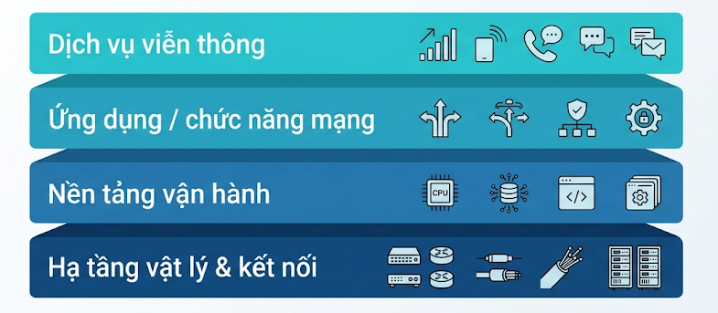

*Hình 1. Các lớp thành phần tạo nên dịch vụ viễn thông.*

Khi có cảnh báo về liên kết hoặc phản ánh dịch vụ suy giảm, kỹ sư cần xác định thành phần phát sinh bất thường, xem trạng thái các thành phần liên quan và kiểm tra chỉ số tại thời điểm xảy ra sự cố. Từ đó, họ khoanh vùng nguyên nhân có thể xảy ra, đánh giá phạm vi ảnh hưởng, quyết định bước kiểm tra hoặc xử lý và theo dõi dịch vụ sau khi khôi phục. Một cảnh báo ban đầu chỉ là **điểm khởi đầu điều tra**, chưa đủ để kết luận nguyên nhân.

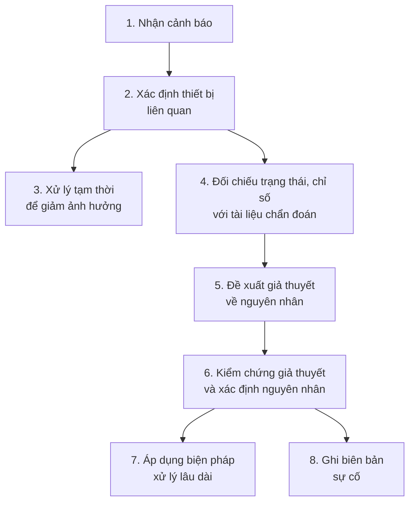

*Hình 2. Luồng điều tra và khắc phục sự cố của các kỹ sư vận hành mạng.*

Khó khăn là những thông tin ấy thường được tổ chức ở các nguồn hoặc góc nhìn khác nhau. Kỹ sư phải đối chiếu cảnh báo xảy ra khi nào, thành phần nào có quan hệ với điểm lỗi và chỉ số nào thay đổi cùng thời điểm. Nếu thiếu quan hệ phụ thuộc hoặc dữ liệu không khớp định danh, thời gian, việc liên hệ một bất thường ở thiết bị với ảnh hưởng tới dịch vụ càng khó khăn. Bước điều tra tiếp theo vì thế phụ thuộc nhiều vào việc kỹ sư tự tổng hợp bối cảnh và kiểm chứng các giả thuyết.

Khi không thể nhanh chóng ghép các thông tin trên thành một bức tranh nhất quán, việc khoanh vùng, đánh giá ảnh hưởng và lựa chọn hướng xử lý có thể bị chậm trễ, kéo dài thời gian gián đoạn dịch vụ. Đây là bối cảnh của bài toán hỗ trợ điều tra sự cố được trình bày ở các phần tiếp theo.

# II. Giải pháp hiện tại và vấn đề

Hiện nay, nhiều doanh nghiệp viễn thông sử dụng các nền tảng chuyên dụng để quản lý thông tin tài nguyên mạng, thu thập dữ liệu trạng thái và hiệu năng, cũng như tiếp nhận cảnh báo từ thiết bị. Các công cụ này cung cấp những thông tin cần thiết cho việc xử lý sự cố. Tuy nhiên, khi điều tra một cảnh báo cụ thể, kỹ sư vẫn gặp phải hai khó khăn chính trong quy trình xử lý sự cố.

## 1. Sử dụng cảnh báo để thu thập thông tin vận hành của các thiết bị liên quan

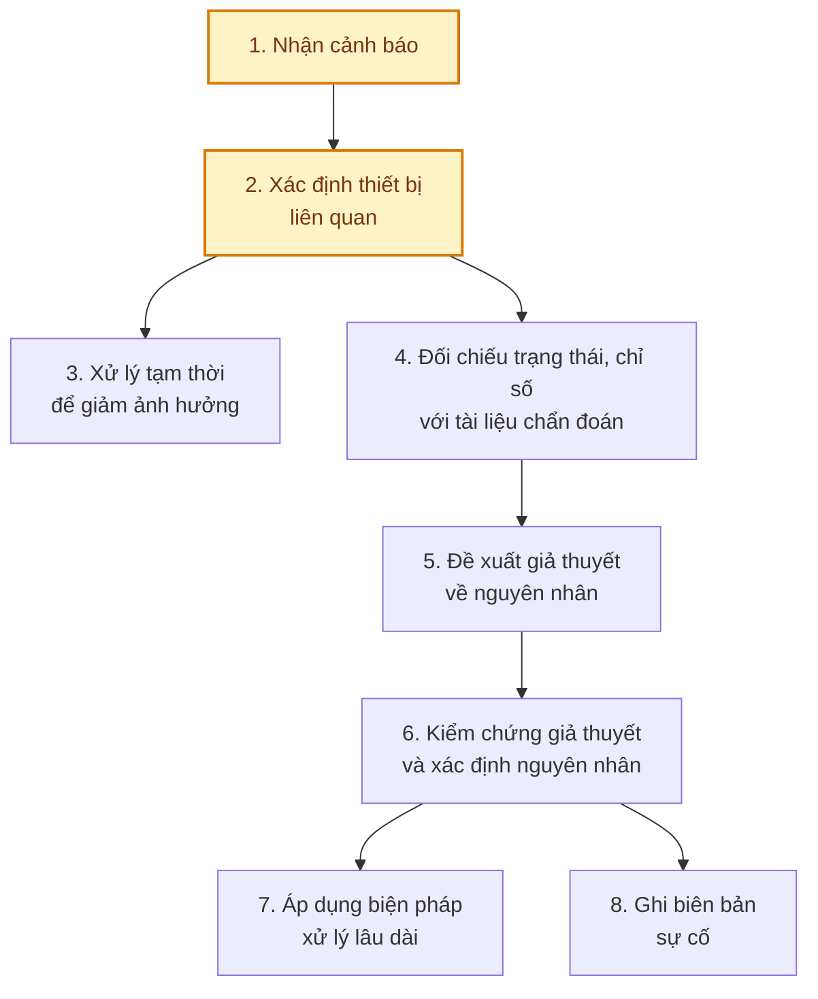

*Hình 3. Việc sử dụng cảnh báo để thu thập thông tin vận hành của các thiết bị là bước 1 và 2 của quy trình khắc phục sự cố.*

Giao diện vận hành của doanh nghiệp thường được tổ chức theo chức năng quản lý: trang cảnh báo hiển thị các sự kiện kèm thông tin cơ bản như loại cảnh báo, thời điểm, nguồn phát và mức độ nghiêm trọng; trang thiết bị hỗ trợ tra cứu thông tin tài nguyên; trang giám sát cung cấp trạng thái và chỉ số vận hành. Như vậy, dữ liệu cần thiết cho bước điều tra ban đầu đã tồn tại, nhưng nằm ở các màn hình khác nhau; khi xử lý một cảnh báo cụ thể, kỹ sư phải tự kết nối chúng lại với nhau.

Bên cạnh đó, viêc phân trang theo tài nguyên quản lý khiến cho mô hình quản lý phân cấp trở nên rất phổ biến. Giao diện phân cấp theo khu vực, nhóm tài nguyên và thiết bị giúp xác định vị trí của một đối tượng trong phạm vi quản lý một cách nhanh chóng. Tuy nhiên, việc chuẩn đoán sự cố thường dựa trên các thành phần có quan hệ với nhau. Các thành phần đó có thể nằm ở những nhánh hoặc lớp khác nhau. Do dó, chỉ nhìn theo cấu trúc phân cấp sẽ khó lần theo quan hệ giữa chúng một cách trực quan. Kỹ sư vì thế có thể phải mở lần lượt nhiều nhánh để tự ghép bối cảnh của sự cố.

Ví dụ một tình huống sau: router `R-HN-01` phát sinh packet-error tăng đột biến trên cổng `WAN-01` lúc 14:32, kỹ sư cần tìm hiểu lý do. Bắt đầu ở trang cảnh báo, kỹ sư nhận thấy cảnh báo `ALM-2041` trên `R-HN-01` lúc 14:32 — nhưng chỉ gồm thông tin cơ bản và không kèm ngữ cảnh về đầu xa liên kết hay các thiết bị liên quan. Kỹ sư phải lấy mã thiết bị từ cảnh báo để tiếp tục tra cứu ở các trang khác.

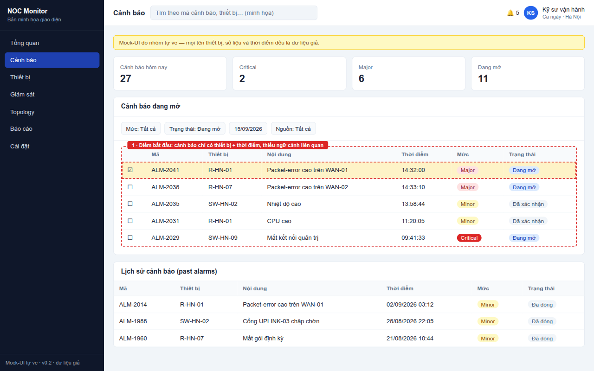

*Hình 4. Trang cảnh báo: dòng `ALM-2041` cho biết thiết bị, thời điểm và mức độ, nhưng không cho biết liên kết gặp sự cố nối tới đâu hay cần kiểm tra thêm thành phần nào.*

Sang trang thiết bị, kỹ sư tìm được `R-HN-01` theo cây phân cấp khu vực — nhóm — thiết bị. Tuy nhiên, đầu xa của liên kết là switch `SW-HN-02` lại nằm ở một nhánh khác, còn bảng cổng của `R-HN-01` không hiển thị thông tin đầu xa. Kỹ sư vì thế phải mở lần lượt nhiều nhánh mới ghép được quan hệ giữa các thành phần.

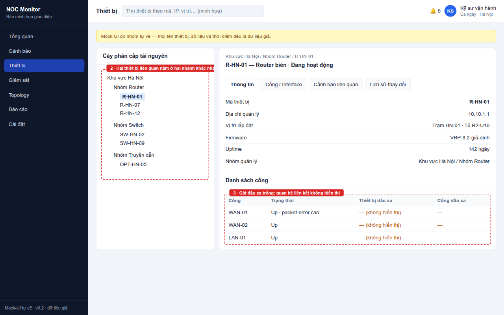

*Hình 5. Trang thiết bị: hai thiết bị có liên kết trực tiếp nằm ở hai nhánh phân cấp khác nhau; cột thiết bị đầu xa để trống nên quan hệ liên kết không thể hiện trực quan.*

Cuối cùng, để xem diễn biến packet-error, kỹ sư phải sang trang giám sát và tự nhập mã thiết bị, chọn cổng `WAN-01` cùng khoảng thời gian 14:00–15:00. Biểu đồ cho thấy đỉnh bất thường trùng với thời điểm cảnh báo, nhưng việc đối chiếu này do kỹ sư thực hiện thủ công; trang giám sát cũng không tự gợi ý cổng đối tác cần kiểm tra thêm.

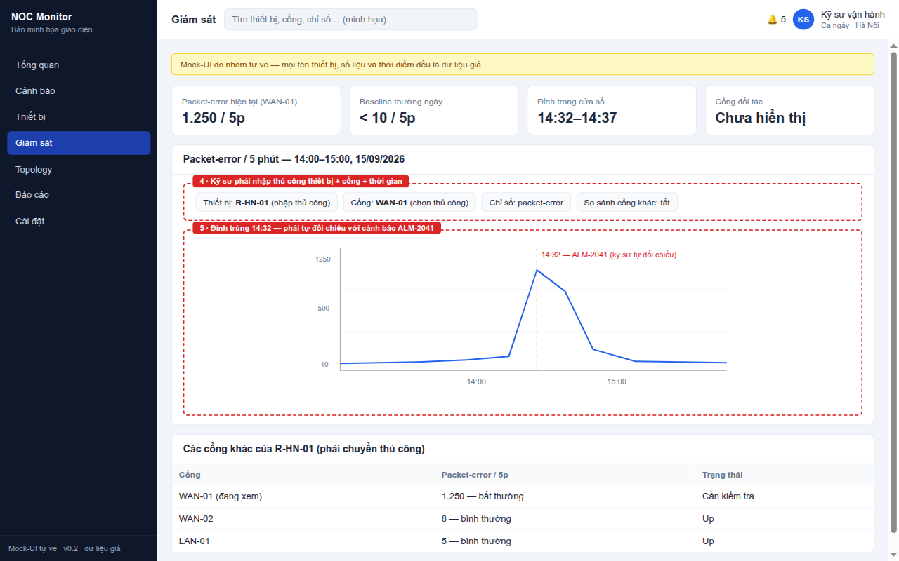

*Hình 6. Trang giám sát: đỉnh packet-error trùng thời điểm cảnh báo, nhưng kỹ sư phải tự chọn thiết bị, cổng, khoảng thời gian và tự đối chiếu với cảnh báo `ALM-2041`.*

Như vậy, trong cùng một tình huống, kỹ sư phải chuyển qua ba trang để thu thập đủ thông tin do thông tin rời rạc, không tập trung. Ngay cả khi đã tìm đúng thiết bị, quan hệ với các thành phần liên quan vẫn khó quan sát dưới góc nhìn phân cấp. Sau khi có trạng thái và chỉ số của các thành phần, bước tiếp theo là đối chiếu chúng để hình thành giả thuyết về nguyên nhân.

## 2. Từ dữ liệu vận hành để đưa ra các giả thuyết cho nguyên nhân

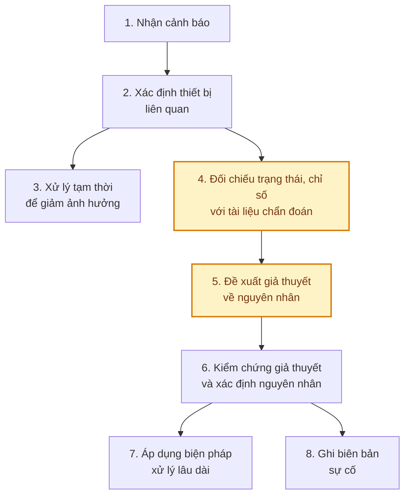

*Hình 7. Việc sử dụng dữ liệu vận hành kết hợp với tài liệu chuẩn đoán là bước 4 và 5 của quy trình khắc phục sự cố.*

Sau khi xác định được thành phần cần kiểm tra, kỹ sư có thể xem trạng thái, chỉ số hiệu năng theo thời gian và những cảnh báo liên quan trên các công cụ giám sát. Tài liệu kỹ thuật hoặc quy trình chẩn đoán cung cấp thêm thông tin để nhận diện dấu hiệu và lựa chọn phép kiểm tra phù hợp. Những nguồn này giúp kỹ sư hình thành giả thuyết trước khi kiểm chứng nguyên nhân ở bước tiếp theo.

Khó khăn xuất hiện khi cần đối chiếu nhiều loại thông tin: chỉ số nào thay đổi trước hoặc sau cảnh báo, các thành phần liên quan có biểu hiện tương tự không, và dấu hiệu đó phù hợp với trường hợp nào trong tài liệu. Khi dữ liệu và tài liệu chưa được trình bày cùng một ngữ cảnh điều tra, kỹ sư phải tự tìm kiếm, so sánh và tổng hợp bằng chứng. Công việc này có thể mất thời gian và phụ thuộc vào kinh nghiệm của kỹ sư mạng.

Như vậy, giải pháp hiện tại đã cung cấp cảnh báo, thông tin tài nguyên, dữ liệu giám sát và tài liệu chẩn đoán, nhưng việc liên kết chúng theo thiết bị, quan hệ phụ thuộc và thời điểm trong một tình huống sự cố vẫn đòi hỏi nhiều thao tác của kỹ sư. Đây là khoảng trống mà bài toán hỗ trợ điều tra hướng tới.

# III. Định nghĩa bài toán

## 1. Phát biểu bài toán

Bài toán được đặt ra nhằm hỗ trợ kỹ sư điều tra sự cố mạng. Từ một cảnh báo hoặc một câu hỏi điều tra của kỹ sư, hệ thống tổng hợp dữ liệu vận hành, thông tin quan hệ giữa các thành phần và tài liệu kỹ thuật hoặc nghiệp vụ liên quan trong phạm vi đã chọn, để hỗ trợ đưa ra các giả thuyết về nguyên nhân và đề xuất bước kiểm tra tiếp theo.

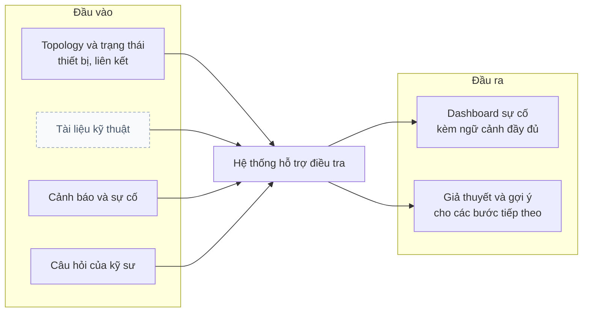

*Hình 8. Ranh giới đầu vào/đầu ra của bài toán.*

## 2. Đầu vào

### a. Topology hệ thống

Trong hệ thống này, mỗi node của topology là **một thiết bị đang được quản lý**. Đây là đơn vị nhỏ nhất mà hệ thống theo dõi được trạng thái, chỉ số và phát sinh cảnh báo. Vì mỗi cảnh báo và mỗi chuỗi chỉ số đều gắn với đúng một thiết bị, hoặc với đúng một liên kết giữa hai thiết bị, nên khi điều tra sự cố, hệ thống không phải suy ra thiết bị nào từ một vị trí địa lý. Phạm vi của loại thiết bị được giới hạn ở tầng Internet theo quy ước TCP/IP, tức tầng định tuyến.

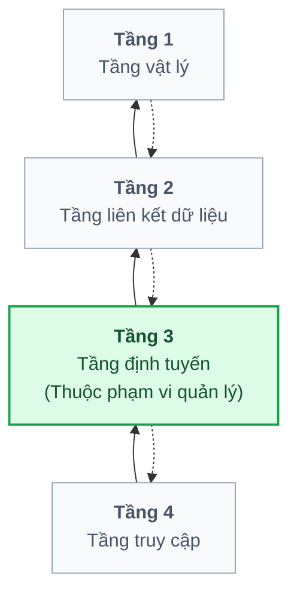

*Hình 9. Bốn tầng của mô hình TCP/IP; hệ thống chỉ quản lý thiết bị ở tầng định tuyến.*

Thiết bị được chia thành năm nhóm theo vai trò trong mạng. Ba nhóm đầu tương ứng với ba tầng của kiến trúc mạng lõi. Loại thứ nhất là **router lõi**, chịu trách nhiệm chuyển mạch giữa các vùng và định tuyến xuyên tỉnh, quốc tế. Bên dưới lớp lõi, ta có **router biên tỉnh và router tổng hợp**, chịu trách nhiệm tổng hợp lưu lượng từ các tổng đài vùng và định tuyến nội bộ tỉnh. Nằm ở dưới cùng, ta có **switch tổng đài và switch khu vực**, với chức năng tập trung lưu lượng thuê bao và đưa lên phía trên; đây là lớp có số lượng thiết bị nhiều nhất.

Ngoài ba nhóm trên, hệ thống còn ghi nhận hai nhóm thiết bị khác là **router biên cấp quốc gia** đặt tại các điểm kết nối với mạng khác, và thiết bị của **điểm giao với đối tác (Peering/IXP)**.

Mỗi thiết bị trong topology được lưu thành một bản ghi gồm hai nhóm thông tin là **thông tin định danh** và **thông tin trạng thái**. Nhóm định danh gồm loại thiết bị theo một trong năm nhóm đã nêu ở trên, định danh quản lý, vị trí lắp đặt, và thông số phần cứng gồm hãng sản xuất, dòng sản phẩm và model chính xác. Đây là thông tin tĩnh, mô tả đặc tính của thiết bị và thường được cung cấp một cách thủ công. Nhóm trạng thái là các thông tin vận hành của thiết bị gồm trạng thái hoạt động, thời gian hoạt động liên tục kể từ lần khởi động gần nhất, mức độ tải và thông tin bảng định tuyến (số mạng con được học, số mạng con đang dùng). Đây là thông tin động, có sự thay đổi thường xuyên và thường được cung cấp bởi chính thiết bị. Trên thực tế, dữ liệu này được lưu dưới dạng đầu ra của các câu lệnh truy vấn trạng thái. Mỗi khi kỹ sư muốn cập nhật thông tin trạng thái của thiết bị, họ gửi câu lệnh truy vấn trạng thái tới thiết bị hoặc một hệ thống quản lý thiết bị.

Mỗi liên kết giữa hai thiết bị trong topology cũng được chia thành hai nhóm thông tin là **thông tin định danh** và **thông tin trạng thái**. Thông tin định danh của liên kết gồm hai đầu liên kết, trong đó mỗi đầu là một thiết bị cùng cổng của thiết bị đó, cùng với thông tin về phương tiện truyền và dung lượng tối đa; đây là thông tin tĩnh. Thông tin trạng thái của liên kết gồm tải, tỷ lệ lỗi và trạng thái vận hành được ghi kèm theo mốc thời gian thu thập.

### b. Tài liệu kỹ thuật

Tài liệu kỹ thuật mà hệ thống xử lý bao gồm **đặc tả kỹ thuật**, **hướng dẫn vận hành** và **tài liệu wiki nội bộ**. **Đặc tả kỹ thuật** mô tả các thông số kỹ thuật của thiết bị như đặc tính phần cứng, khả năng và giới hạn của từng loại cổng, giao thức được hỗ trợ, và các yêu cầu về môi trường vận hành; loại tài liệu này do nhà sản xuất hoặc nhà cung cấp thiết bị ban hành và thường áp dụng chung cho cả một dòng sản phẩm. **Hướng dẫn vận hành** mô tả trình tự thao tác cho các công việc thường ngày trên thiết bị như cấu hình ban đầu, thay thế linh kiện, nâng cấp phần mềm, và xử lý sự cố thường gặp; loại tài liệu này do bộ phận kỹ thuật của mạng biên soạn dựa trên đặc tả của nhà sản xuất cùng kinh nghiệm vận hành thực tế. **Tài liệu wiki nội bộ** ghi lại các quy ước và kinh nghiệm riêng của mạng, ví dụ cách đặt định danh thiết bị, nguyên tắc phân cấp địa lý trong việc bố trí thiết bị, và các bài học rút ra từ sự cố đã xảy ra; loại tài liệu này được các kỹ sư trong đội ngũ vận hành viết và cập nhật liên tục. Trước khi được hệ thống sử dụng, các tài liệu trên được coi là đã được tiền xử lý thành tài liệu dạng chữ.

### c. Cảnh báo

Đầu vào cảnh báo trong hệ thống được tổ chức theo hai cấp. **Cấp dưới là cảnh báo**, là đơn vị nhỏ nhất mà hệ thống tiếp nhận, mỗi cảnh báo gắn với đúng một thiết bị và gồm các thông tin định danh là mã lỗi, định danh thiết bị, thời điểm phát sinh, mức độ thuộc một trong hai mức **warning** và **error**, và nội dung thông báo. **Cấp trên là sự cố**, là bản ghi công việc gom nhiều cảnh báo lại, thời điểm mở, trạng thái hiện tại và danh sách các cảnh báo thuộc về nó. Vì các cảnh báo trong cùng một sự cố có thể phát sinh ở những thời điểm khác nhau và trên những thiết bị khác nhau, nên sự cố mang ý nghĩa một vấn đề đang diễn ra, còn cảnh báo chỉ là một dấu vết đơn lẻ của vấn đề đó. Việc gộp và chống lặp cảnh báo được thực hiện bởi hệ thống giám sát bên ngoài trước khi chuyển giao, nên không thuộc phạm vi của dự án; đầu vào mà hệ thống tiếp nhận đã qua bước này.

Đầu vàu cảnh báo thuộc một trong hai loại. **Cảnh báo theo mã lỗi** được tạo ra khi thiết bị gặp lỗi và phát ra mã lỗi kèm theo, nên mã lỗi mang ý nghĩa do nhà sản xuất quy định và cần tra trong tài liệu mã lỗi do nhà sản xuất ban hành. **Cảnh báo theo định nghĩa** không đến từ thiết bị, mà do các kỹ sư viết ra các phép kiểm tra dựa trên trạng thái và chỉ số của thiết bị; khi một phép kiểm tra không đạt thì hệ thống giám sát bên ngoài tạo ra cảnh báo rồi chuyển giao, và mã lỗi lúc này là mã theo quy ước nội bộ nên cần tra trong tài liệu wiki nội bộ.

### d. Câu hỏi của kỹ sư

Câu hỏi của kỹ sư là đầu vào không có cấu trúc cố định. Vì mọi dữ liệu vận hành đều gắn với một thiết bị hoặc một liên kết, và với một khoảng thời gian, nên câu hỏi được tiếp nhận cùng với hai thông tin này: đối tượng mà câu hỏi nhắm tới và khoảng thời gian quan tâm, trong đó đối tượng mặc định là sự cố hoặc cảnh báo đang được mở trên giao diện và kỹ sư có thể chỉ định lại, còn khoảng thời gian mặc định lấy quanh thời điểm phát sinh của đối tượng đó. Câu hỏi của kỹ sư được lưu lại thành hội thoại và lượt hỏi sau được tiếp tục trên hội thoại đó, nên khi kỹ sư hỏi tiếp mà không nhắc lại đối tượng, hệ thống dùng lại đối tượng và khoảng thời gian của lượt trước.

Câu hỏi của kỹ sư không phải là một dạng đầu ra riêng, mà là ngữ cảnh đầu vào mà hệ thống dùng để định hướng việc hiển thị: câu hỏi đang được xét chỉ hiện lên đầu màn hình, còn sự cố và cảnh báo được ghim trong cuộc hội thoại là bối cảnh mặc định cho các lượt hỏi sau.

Hệ thống chỉ nhận câu hỏi về việc quản lý thiết bị mạng trong phạm vi nó quản lý, và ở mọi trường hợp hệ thống chỉ đưa ra gợi ý chứ không thực thi hành động. Vì vậy, một câu hỏi nằm ngoài phạm vi quản lý mạng sẽ không có nguồn dữ liệu để trả lời và hệ thống nói rõ giới hạn đó; còn một câu hỏi thuộc đúng phạm vi quản lý mạng nhưng yêu cầu thực thi thao tác vẫn được hệ thống gợi ý cách thực hiện, đồng thời nêu rõ rằng việc thực thi thuộc về kỹ sư chứ không phải hệ thống.

## 3. Đầu ra

### a. Dashboard sự cố kèm ngữ cảnh đầy đủ

Với một sự cố đang được chọn, dashboard sẽ hiển thị:
- Thông tin của sự cố: thời điểm mở và trạng thái hiện tại (ví dụ `13:58:44`, `PRIORITIZED`).
- Danh sách các cảnh báo thuộc về sự cố, xếp cạnh nhau theo mốc thời gian, mỗi cảnh báo gồm mã lỗi, định danh thiết bị, thời điểm phát sinh, mức độ và nội dung thông báo (ví dụ `ALM-2035` trên `SW-HN-02` lúc `13:58:44` với mức độ `warning`; `ALM-2041` trên `R-HN-01` lúc `14:32:00` với mức độ `error` và nội dung nêu chỉ số `packet-error` tại cổng `WAN-01` đạt `1.250`).
- Thông tin định danh của thiết bị phát cảnh báo sớm nhất, gồm loại thiết bị, định danh quản lý, vị trí lắp đặt, và thông số phần cứng gồm hãng sản xuất, dòng sản phẩm và model chính xác (ví dụ `switch khu vực`, `SW-HN-02`, hãng `Cisco`, dòng `Catalyst 9300`, model `C9300-48UXM`).
- Trạng thái hiện tại của thiết bị đó, gồm trạng thái hoạt động, thời gian hoạt động liên tục kể từ lần khởi động gần nhất, mức độ tải và thông tin bảng định tuyến (ví dụ hoạt động trong `27 ngày 2 giờ`, tải `41%`, đã học `22` mạng con và đang dùng `19` mạng con).
- Giá trị và lịch sử của chỉ số quanh thời điểm phát sinh, bao gồm giá trị tại thời điểm phát sinh, biên độ tăng và xu hướng trước, sau sự kiện.
- Đồ thị liên kết của thiết bị đó với các thiết bị khác, có thể mở rộng dần theo thao tác. Mỗi cạnh là một liên kết và hiển thị hai thông tin nhóm: **thông tin định danh** gồm hai đầu liên kết, trong đó mỗi đầu là một thiết bị cùng cổng của thiết bị đó, cùng phương tiện truyền và dung lượng tối đa; **thông tin trạng thái** gồm tải, tỷ lệ lỗi và trạng thái vận hành, ghi kèm mốc thời điểm thu thập (ví dụ `SW-HN-02:UPLINK-03 ↔ R-HN-01:WAN-01`, quang `10 G`, tải `41%`, tỷ lệ lỗi `0.5%`, trạng thái vận hành `đang hoạt động`).

Các thành phần này được gắn với nhau bằng liên kết có thể bấm: bấm vào một cảnh báo trong danh sách sẽ đưa cảnh báo đó vào ngữ cảnh điều tra, bấm vào mã lỗi sẽ mở đoạn tài liệu kỹ thuật mô tả mã lỗi đó, bấm vào thiết bị sẽ đổi sang khung thông tin của thiết bị đó ngay trên dashboard này, bấm vào nút lá của đồ thị để mở rộng thêm liên kết, và bấm vào mốc thời gian sẽ mở biểu đồ chỉ số tại đúng cửa sổ phát sinh. Như vậy, những thông tin vốn nằm rải rác ở các trang cảnh báo, thiết bị và giám sát được gom về một màn hình theo cùng một định danh tài nguyên, và việc xác định phạm vi ảnh hưởng của một sự cố được thực hiện ngay trên cùng một màn hình.

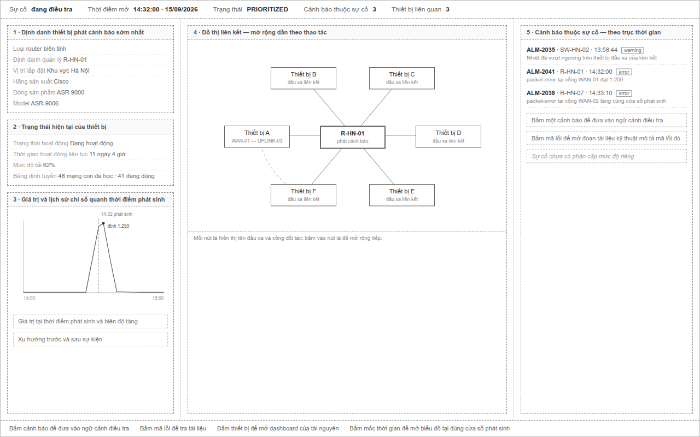

*Hình 10. Wireframe bố cục dashboard sự cố.*

### b. Giả thuyết và gợi ý cho các bước tiếp theo

Trên cơ sở ngữ cảnh của sự cố đang được mở, hệ thống đề xuất một danh sách giả thuyết nguyên nhân được xếp hạng, kèm bằng chứng và phép kiểm tra tương ứng cho từng giả thuyết. Hệ thống chỉ gợi ý, không kết luận nguyên nhân; kỹ sư vẫn phải kiểm chứng trước khi quyết định biện pháp xử lý. Mỗi giả thuyết hiển thị:
- Tên giả thuyết và thứ hạng, ví dụ lỗi vật lý hoặc lỗi tính hiệu trên liên kết `R-HN-01:WAN-01`.
- Cơ sở xếp hạng, nêu rõ tiêu chí như số bằng chứng độc lập, mức khớp với tài liệu và khoảng cách thời gian; đây là tín hiệu để đối chiếu chứ không phải xác suất tuyệt đối.
- Các bằng chứng ủng hộ, mỗi bằng chứng kèm nguồn trích dẫn: giá trị chỉ số tại thời điểm phát sinh, cảnh báo khác thuộc cùng sự cố, quan hệ liên kết, hoặc đoạn tài liệu kỹ thuật mô tả mã lỗi.
- Các bằng chứng không phù hợp đối với giả thuyết hiện tại.
- Phép kiểm tra đề xuất cho từng giả thuyết: thao tác cụ thể, dữ liệu cần thu thập, và kết quả kỳ vọng nếu giả thuyết đúng hay sai.

Ví dụ, với sự cố mở lúc `13:58:44` mà cảnh báo `ALM-2035` trên `SW-HN-02` là dấu vết sớm nhất, hệ thống gợi ý kiểm tra thống kê lỗi `CRC/FCS` ở cả hai đầu liên kết (`UPLINK-03` trên `SW-HN-02` và `WAN-01` trên `R-HN-01`): nếu lỗi chỉ xuất hiện ở một đầu thì nghiêng về lỗi cổng, nếu xuất hiện ở cả hai đầu thì nghiêng về lỗi đường truyền, và kết quả thu được được ghi nhận lại làm bằng chứng cho vòng đánh giá tiếp theo.

Mỗi bằng chứng và mỗi phép kiểm tra đều là liên kết có thể bấm, cho phép kỹ sư chuyển thẳng tới vị trí hiển thị bằng chứng đó trên dashboard hoặc chạy phép kiểm tra ngay tại đây. Nhờ vậy, việc hình thành và kiểm chứng giả thuyết được thực hiện có hệ thống thay vì phụ thuộc hoàn toàn vào kinh nghiệm cá nhân.

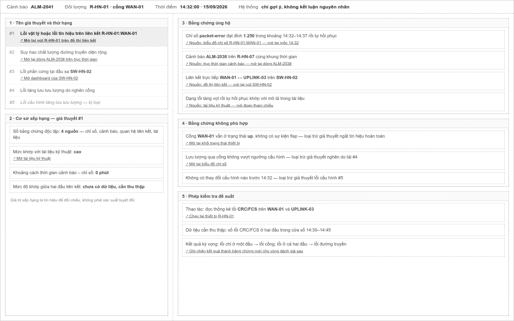

*Hình 11. Wireframe danh sách giả thuyết và phép kiểm tra đề xuất.*
