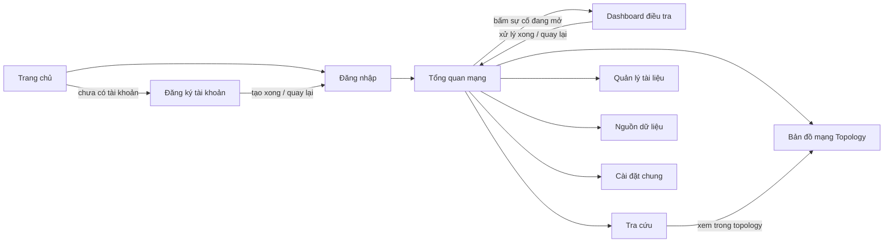

# Bản đồ trang ứng dụng

Tài liệu liệt kê toàn bộ trang của hệ thống, quy ước điều hướng giữa các trang, và trạng thái thiết kế của từng trang. Dashboard điều tra sự cố là một trang trong số này — vì phức tạp nhất nên có thư mục thiết kế riêng (`dashboard-page-stylebook/`, ch0–ch5). Từ ngày 10-11, mỗi trang được đặc tả bằng **một trang thiết kế tương tác** trong thư mục `app-pages/` (miniature của trang ở giữa, hai sidebar card giải thích xung quanh); tài liệu này giữ vai trò **bản đồ + tóm tắt**, trỏ về trang tương tác của từng trang.

# Mục lục

- [I. Nguyên tắc](#i-nguyên-tắc)
- [II. Sơ đồ điều hướng](#ii-sơ-đồ-điều-hướng)
- [III. Bảng tổng hợp](#iii-bảng-tổng-hợp)
- [IV. Đặc tả từng trang](#iv-đặc-tả-từng-trang)
  - [1. Trang chủ](#1-trang-chủ)
  - [2. Đăng nhập](#2-đăng-nhập)
  - [3. Đăng ký tài khoản](#3-đăng-ký-tài-khoản)
  - [4. Tổng quan mạng](#4-tổng-quan-mạng)
  - [5. Dashboard điều tra sự cố](#5-dashboard-điều-tra-sự-cố)
  - [6. Tra cứu thiết bị, liên kết, dịch vụ](#6-tra-cứu-thiết-bị-liên-kết-dịch-vụ)
  - [7. Quản lý tài liệu](#7-quản-lý-tài-liệu)
  - [8. Cấu hình nguồn dữ liệu](#8-cấu-hình-nguồn-dữ-liệu)
  - [9. Cài đặt chung](#9-cài-đặt-chung)
  - [10. Bản đồ mạng (Topology)](#10-bản-đồ-mạng-topology)
- [V. Trang không làm](#v-trang-không-làm)

# I. Nguyên tắc

- Ứng dụng gồm **10 trang** (Đăng ký thêm 11-11; Trang chủ + Tổng quan mạng thêm 12-11; Nguồn dữ liệu + Cài đặt thêm 12-11; Bản đồ mạng Topology thêm 16-11 phục vụ góc nhìn hạ tầng độc lập không ràng buộc sự cố). Dashboard điều tra sự cố là trang trung tâm xử lý sự cố; Bản đồ mạng Topology là không gian làm việc trực quan hóa hạ tầng viễn thông chuyên sâu; các trang còn lại phục vụ một tác vụ đơn lẻ mỗi trang.
- **Format đặc tả một trang — trang thiết kế tương tác** trong `app-pages/` (một HTML mỗi trang, dùng chung `css/app-pages.css` + `js/app-pages.js`): **miniature của trang (khung thiết kế 1440×900, tự scale lấp vùng giữa) đặt giữa**, hai sidebar card hai bên — trái = **bố cục & vùng**, phải = **tương tác** (liệt kê thao tác của người dùng trên trang); **rê chuột lên card ở sidebar trái là soi thử vùng tương ứng trên miniature ngay lập tức** (bỏ rê trả về như cũ), **bấm card để chốt** — bấm lại card, Esc hoặc bấm nền bỏ chốt; bấm lên miniature không đổi vùng soi, các nút trạng thái chạy demo ngay trên miniature. **Trang phức tạp** (Dashboard điều tra và Bản đồ Topology) chia sẻ ngôn ngữ canvas phân tầng 5 lớp và hệ thống Inspector.
- Dashboard điều tra là **một trang duy nhất** với các trạng thái theo hành trình điều tra (tiếp nhận → điều tra → soi thiết bị → đánh giá ảnh hưởng → xử lý xong). Năm file prototype giai đoạn trong README (01→05) là năm trạng thái của cùng một trang, không phải năm trang riêng.
- Đã thiết kế đủ 10 trang: Dashboard (`dashboard-page-stylebook/` ch0–ch5), Bản đồ mạng Topology, Đăng nhập, Đăng ký, Trang chủ, Tổng quan mạng, Tra cứu, Quản lý tài liệu, Nguồn dữ liệu, Cài đặt.
- **Bảng + panel chi tiết** là pattern dùng chung của Tra cứu và Quản lý tài liệu (khối `.vp-thead`/`.vp-trow`/`.vp-chip` chia sẻ trong `css/app-pages.css`) — chip trạng thái một ngôn ngữ trên cả hai trang.
- **Token màu & font dùng chung một nguồn** (`design-tokens.css` đặt cạnh hai thư mục thiết kế, thêm 13-11): cả stylebook dashboard lẫn các trang tương tác đều link cùng một file token — palette giấy/mực, màu nhấn, bộ ba trạng thái (gốc + nền mờ/viền/chữ cho chip & băng), màu canvas topology, site/tier, và hai họ font. Sửa giá trị chỉ tại file này để style không lệch giữa các trang; từng trang chỉ còn CSS bố cục & thành phần riêng. Chrome điều hướng của tài liệu (tab trang, nút trạng thái) theo ngôn ngữ stylebook: nhãn mono, trạng thái chọn nền mực. Font web chọn **Inter + JetBrains Mono** (thêm 13-11, nạp qua Google Fonts CDN, offline thì fallback về system font) — tiêu chí đầu là dấu tiếng Việt sạch ở cỡ nhỏ và nhất quán giữa máy của kỹ sư.

# II. Sơ đồ điều hướng

- Chưa đăng nhập: vào **Trang chủ** trước — hai nút dẫn sang Đăng nhập và Đăng ký. Đề xuất: nếu phiên cũ còn hợp lệ, nút chính đổi thành "Tiếp tục phiên làm việc" vào thẳng Tổng quan.
- Sau đăng nhập, trang mặc định là **Tổng quan mạng**; nếu có sự cố đang được xử lý dở, hệ thống hỏi "tiếp tục điều tra INC-xx?" và vào thẳng Dashboard nếu đồng ý.
- Chưa có tài khoản: link "Đăng ký" dưới form Đăng nhập mở trang Đăng ký; sau khi tạo tài khoản (kích hoạt qua email — đề xuất), quay lại Đăng nhập.
- **Thanh điều hướng chính nằm trong topbar, hiện ở mọi trang sau đăng nhập**: Tổng quan · Bản đồ · Điều tra · Tra cứu · Tài liệu · Nguồn dữ liệu · Cài đặt. Trang chủ (chưa đăng nhập) có thanh riêng: chỉ brand + hai nút Đăng nhập/Tạo tài khoản. Sơ đồ trên chỉ vẽ luồng chính; thực tế từ bất kỳ trang nào cũng sang được trang bất kỳ khác qua topbar.
- Khi ở Dashboard điều tra, topbar giữ bố cục ch0 (brand + chip sự cố INC-07 và trạng thái xử lý). Khi ở Bản đồ Topology độc lập, topbar hiển thị thanh điều hướng chuẩn cùng chip tiêu điểm thiết bị đang soi (`FOCUS: NODE-ID (k-Hop)` hoặc `TOÀN MẠNG`).
- Đi sâu từ Tra cứu: chọn một thiết bị → nút "Xem trong topology" mở thẳng trang **Bản đồ mạng (Topology)** với thiết bị đó ở trạng thái focus và hiển thị bán kính lân cận (không yêu cầu thiết bị phải nằm trong sự cố).

# III. Bảng tổng hợp

| # | Trang | Mục đích | Ai dùng | Độ phức tạp | Trạng thái thiết kế |
|---|-------|----------|---------|-------------|---------------------|
| 1 | Trang chủ | Cổng vào cho người dùng chưa đăng nhập — giới thiệu ngắn, dẫn sang Đăng nhập/Đăng ký | Mọi người dùng | Đơn giản | Khung đề xuất — [`app-pages/landing.html`](app-pages/landing.html) |
| 2 | Đăng nhập | Xác thực vào hệ thống | Mọi người dùng | Đơn giản | Khung đề xuất — [`app-pages/login.html`](app-pages/login.html) |
| 3 | Đăng ký tài khoản | Tự đăng ký tài khoản kỹ sư vận hành | Người dùng mới | Đơn giản | Khung đề xuất — [`app-pages/signup.html`](app-pages/signup.html) |
| 4 | Tổng quan mạng | Nhìn nhanh sức khỏe mạng và chọn sự cố để điều tra | Kỹ sư, quản lý vận hành | Trung bình | Khung đề xuất — [`app-pages/overview.html`](app-pages/overview.html) |
| 5 | Dashboard điều tra | Theo dõi, khoanh vùng và xử lý một sự cố trên topology | Kỹ sư trực | Cao | **Đã thiết kế** — `dashboard-page-stylebook/` ch0–ch5 · tóm tắt tương tác — [`app-pages/dashboard.html`](app-pages/dashboard.html) |
| 6 | Tra cứu | Tra cứu thiết bị, liên kết, dịch vụ không gắn với sự cố đang mở | Kỹ sư | Trung bình | Khung đề xuất — [`app-pages/lookup.html`](app-pages/lookup.html) |
| 7 | Quản lý tài liệu | Nạp và quản lý tài liệu kỹ thuật, nghiệp vụ cho AI | Kỹ sư, người phụ trách nội dung | Đơn giản | Khung đề xuất — [`app-pages/documents.html`](app-pages/documents.html) |
| 8 | Nguồn dữ liệu | Cấu hình hệ thống nguồn bên thứ ba và mapping dữ liệu | Quản trị hệ thống | Trung bình | Khung đề xuất — [`app-pages/sources.html`](app-pages/sources.html) |
| 9 | Cài đặt chung | Tùy chỉnh giao diện toàn ứng dụng, lưu vĩnh viễn | Mọi người dùng | Đơn giản | Khung đề xuất — [`app-pages/settings.html`](app-pages/settings.html) |
| 10 | Bản đồ mạng (Topology) | Quan sát trực quan toàn bộ mạng viễn thông, soi thiết bị & liên kết tự do, duyệt k-Hop ego-network không gắn với sự cố | Kỹ sư vận hành, quy hoạch mạng | Cao | **Đã thiết kế** — [`app-pages/topology.html`](app-pages/topology.html) |

# IV. Đặc tả từng trang

Mỗi mục dưới đây chỉ là tóm tắt — đặc tả đầy đủ nằm trong trang tương tác tương ứng của thư mục `app-pages/`.

## 1. Trang chủ

**Đã đặc tả: [`app-pages/landing.html`](app-pages/landing.html)** — miniature trang chủ ở giữa (5 vùng: thanh trên cùng, thông điệp chính, hai nút hành động, ba khối năng lực, chân trang), hai sidebar giải thích, demo 2 trạng thái (mặc định, có phiên cũ).

Tóm tắt thiết kế: lớp giới thiệu mỏng nhẹ — thanh trên cùng chỉ có brand + hai nút xác thực; một thông điệp nói rõ công cụ làm gì; ba khối năng lực (TOPOLOGY, ĐIỀU TRA, TRA CỬU) trỏ thẳng ba vùng cốt lõi của app thay vì liệt kê tính năng chung chung. Đề xuất chờ gật: nút "Tạo tài khoản" (đường phụ, giống link Đăng ký ở trang Đăng nhập) và trạng thái "có phiên cũ" — nút chính đổi thành "Tiếp tục phiên làm việc" vào thẳng Tổng quan.

## 2. Đăng nhập

**Đã đặc tả: [`app-pages/login.html`](app-pages/login.html)** — miniature trang đăng nhập ở giữa (7 vùng: khối nhận diện, hai trường nhập + hàng ghi nhớ/quên mật khẩu, nút chính, link SSO, panel phải nền tối, chuyển ngôn ngữ, chân trang), hai sidebar giải thích, demo 4 trạng thái (mặc định, lỗi, đang xử lý, thành công).

Tóm tắt thiết kế: **bố cục chia đôi** — cột form sáng bên trái (logo tròn đầu cột, tiêu đề lớn, dòng "Chưa có tài khoản? Đăng ký", hai trường với gợi ý viết ngay trong trường, hàng "Ghi nhớ tôi" + "Quên mật khẩu?", nút chính bo tròn đặt giữa, link SSO dưới phân cách "HOẶC") và panel nền tối bên phải có **hoạt ảnh topology nhẹ** — vài nút mạng nhấp nháy chậm, liên kết chảy dữ liệu, nút trung tâm phát sóng quét định kỳ (SVG + CSS thuần, không JS, tự tắt khi bật giảm chuyển động); nội dung thật của panel chờ quyết định. Góc trên phải có cặp nút VI/EN — đổi ngôn ngữ toàn trang ngay trong miniature, mặc định tiếng Việt (đề xuất chờ gật). Form nội bộ là đường chính, SSO là đường phụ (đề xuất chờ gật); lỗi báo inline trong cột, không alert; chân trang ghi phiên bản + môi trường (đề xuất). Sau đăng nhập vào Tổng quan mạng, hoặc thẳng Dashboard nếu có sự cố đang xử lý dở (quy ước ở mục II).

## 3. Đăng ký tài khoản

**Đã đặc tả: [`app-pages/signup.html`](app-pages/signup.html)** — miniature trang đăng ký ở giữa (6 vùng: khối nhận diện, bốn trường nhập, nút chính, panel phải nền tối, chuyển ngôn ngữ, chân trang), hai sidebar giải thích, demo 4 trạng thái (mặc định, mật khẩu không khớp, email đã tồn tại, thành công).

Tóm tắt thiết kế: cùng vỏ ngoài với Đăng nhập (bố cục chia đôi, cột form trái — logo tròn, dòng "Đã có tài khoản? Đăng nhập" chuyển về trang đăng ký, panel tối phải có hoạt ảnh topology nhẹ như Đăng nhập, chân trang môi trường); góc trên phải có cặp nút VI/EN đổi ngôn ngữ như Đăng nhập (đề xuất chờ gật); bốn trường với gợi ý ngay trong trường — họ và tên, email công ty, mật khẩu kèm gợi ý "tối thiểu 8 ký tự" dưới trường, xác nhận mật khẩu; lỗi báo inline đúng vị trí (dưới trường, băng trên form), không alert. Sau tạo tài khoản: gửi email kích hoạt rồi về Đăng nhập (**luồng đề xuất chờ gật** — phương án khác: chờ quản trị duyệt).

## 4. Tổng quan mạng

**Đã đặc tả: [`app-pages/overview.html`](app-pages/overview.html)** — miniature trang tổng quan ở giữa (6 vùng: thanh điều hướng ứng dụng, tiêu đề + thời điểm dữ liệu, bốn thẻ chỉ số, sự cố đang mở, đã xử lý gần đây, chân trang), hai sidebar giải thích, demo 4 trạng thái (mặc định, có phiên dở, đang tải, mới thiết lập).

Tóm tắt thiết kế: trả lời "mạng đang thế nào, việc gì cần xử lý trước" trong một màn hình — bốn thẻ chỉ số sức khỏe trên cùng (nút hoạt động, cảnh báo đang mở, sự cố đang xử lý, cổng mất kết nối, mỗi thẻ kèm dòng phụ chỉ đúng đối tượng), danh sách sự cố đang mở sắp theo mức độ ưu tiên với nút "Mở Dashboard" (lối vào chính của Dashboard), và sự cố đã xử lý gần đây kèm thời gian khôi phục. Nếu còn phiên điều tra dở, băng trên cùng hỏi "tiếp tục điều tra INC-xx?" (quy ước ở mục II). Khác Dashboard: Tổng quan trả lời "chọn việc gì" khi chưa có ngữ cảnh sự cố; Dashboard trả lời "sự cố này là gì" khi đã có.

## 5. Dashboard điều tra sự cố

**Đã đặc tả: [`app-pages/dashboard.html`](app-pages/dashboard.html)** — miniature dashboard ở giữa (6 vùng: header mỏng, sidebar trái 4 tab, canvas topology, cụm nút zoom nổi, legend màu site, Inspector), hai sidebar giải thích, demo 5 trạng thái đại diện — mỗi state tô một hành vi vùng khác nhau, mã state trỏ thẳng vào hình stylebook (thêm 14-11: viết lại đúng spec sau khi bản đầu đi lệch).

Tóm tắt thiết kế: trang trung tâm theo `dashboard-page-stylebook/` (ch0–ch5) — miniature ở đây là bản tóm tắt, chi tiết đầy đủ từng vùng nằm trong stylebook. Header mỏng chỉ có brand + chip sự cố (mã, trạng thái, thời điểm mở); sidebar trái là **4 tab** (Tìm kiếm · Timeline cảnh báo · Giả thuyết AI · Cài đặt hiển thị) — mỗi lần mở một tab, không xếp chồng; canvas chia 5 dải tầng ngang (Peering & Transit → National Border Gateway → Core → Edge Aggregation → Metro Exchange), node = nền sức khỏe + viền màu site + badge "+N" gom lá Access trên node exchange, edge = màu trạng thái / dày băng thông / liền-đứt hiệu suất; Inspector là danh sách thiết bị khi chưa chọn, dải định danh + ba tab khi chọn node, hàng hai đầu kèm cổng thay thanh tab khi chọn edge. Năm trạng thái demo: **Mặc định** (5.1A — Timeline + danh sách thiết bị), **Tìm kiếm** (4.1B+5.1B — beacon CORE-02, ngoài K=2 mờ; Inspector định danh + Quick CLI), **Giả thuyết** (4.3B+C+5.3B — khoanh vùng + beacon hai đầu, chi tiết accordion tại chỗ; Inspector giữ ngữ cảnh AGG-02 tab Trạng thái + telemetry), **Tài liệu** (4.2C+5.2C — panel mã lỗi đè mép trái canvas), **Chọn edge** (5.4 — hàng hai đầu kèm cổng thay thanh tab). Pan, zoom LOD, kéo node, tooltip, đa beacon và xác nhận/bác bỏ giả thuyết là tương tác sống — đặc tả ở stylebook chương 3–4, không làm state riêng.

## 6. Tra cứu thiết bị, liên kết, dịch vụ

**Đã đặc tả: [`app-pages/lookup.html`](app-pages/lookup.html)** — miniature trang tra cứu ở giữa (6 vùng: thanh điều hướng, tìm kiếm + bộ lọc, tab theo loại, bảng tài nguyên, panel chi tiết, chân trang), hai sidebar giải thích, demo 3 trạng thái (mặc định, chưa chọn, không có kết quả).

Tóm tắt thiết kế: tra cứu tài nguyên khi không có sự cố đang mở — ô tìm kiếm lớn (lọc ngay khi gõ, không nút "Tìm") + ba bộ lọc (Lớp, Khu vực, Trạng thái) và tab theo loại kèm số lượng (Thiết bị, Liên kết, Dịch vụ) đứng trên bảng. Chọn một dòng → panel chi tiết bên phải dùng ngôn ngữ hiển thị giống Inspector (ch5) để nhất quán; nút chính "Xem trong topology" mở Dashboard với đối tượng được chọn, hoặc về Tổng quan nếu không có sự cố đang mở (quy ước ở mục II).

## 7. Quản lý tài liệu

**Đã đặc tả: [`app-pages/documents.html`](app-pages/documents.html)** — miniature trang quản lý tài liệu ở giữa (5 vùng: thanh điều hướng, tiêu đề + nút tải lên, bảng tài liệu, xem trước, chân trang), hai sidebar giải thích, demo 3 trạng thái (mặc định, chưa chọn, vừa tải lên).

Tóm tắt thiết kế: nơi kỹ sư nạp tài liệu kỹ thuật, nghiệp vụ cho AI trích dẫn khi điều tra (kho tài liệu trong kiến trúc đề xuất). Bảng liệt kê tên, nguồn, loại, thời điểm cập nhật và **trạng thái lập chỉ mục** — SẴN SÀNG (AI trích dẫn được), ĐANG LẬP CHỈ MỤC, LỖI kèm lý do (tài liệu lỗi không bị AI trích dẫn để tránh dẫn chứng sai). Tải lên xong hiện băng xác nhận + dòng mới với chip "đang lập chỉ mục". Chọn một dòng → xem trước nội dung + meta nguồn + nút thay thế tệp (bản cũ giữ lại — đề xuất). Tài liệu AI trích dẫn trong Dashboard (khối wiki Inspector) phải tìm được về đây theo nguồn. Bố cục bảng + panel dùng chung pattern với Tra cứu.

## 8. Cấu hình nguồn dữ liệu

**Đã đặc tả: [`app-pages/sources.html`](app-pages/sources.html)** — miniature trang nguồn dữ liệu ở giữa (6 vùng: thanh điều hướng, tiêu đề + nút thêm nguồn, danh sách nguồn, cấu hình nguồn đang chọn, lịch sử đồng bộ, chân trang), hai sidebar giải thích, demo 4 trạng thái (mặc định, nguồn hàng đợi, lỗi đồng bộ, đang đồng bộ lại).

Tóm tắt thiết kế: trang quản trị kết nối hệ thống nguồn bên thứ ba (mô-đun tích hợp trong kiến trúc đề xuất). Danh sách nguồn hiển thị tên, kiểu kết nối (REST polling hoặc message queue) và trạng thái lần đồng bộ gần nhất ngay trên dòng — lỗi kèm lý do, không cần mở vào mới biết nguồn nào hỏng. Chọn một nguồn → panel phải đổi sang cấu hình tương ứng: địa chỉ, phương thức đồng bộ và bảng ánh xạ trường dữ liệu vào mô hình của hệ thống (trường chưa ánh xạ cảnh báo vàng). Lịch sử đồng bộ của nguồn đang chọn kèm nút "Đồng bộ lại từ đầu"; nguồn message queue nhận luồng liên tục nên không có lịch sử poll. Thay đổi chỉ có hiệu lực sau khi bấm "Lưu thay đổi". Dữ liệu chỉ đồng bộ một chiều — trang này không gửi ngược gì về hệ thống nguồn.

## 9. Cài đặt chung

**Đã đặc tả: [`app-pages/settings.html`](app-pages/settings.html)** — miniature trang cài đặt ở giữa (6 vùng: thanh điều hướng, tiêu đề, khối chủ đề, khối hiển thị mặc định, khối khôi phục mặc định, chân trang), hai sidebar giải thích, demo 4 trạng thái (mặc định, chủ đề tối, chưa lưu, đã lưu).

Tóm tắt thiết kế: nơi lưu tùy chọn giao diện toàn ứng dụng — khối chủ đề (Sáng / Tối / Theo hệ thống) áp dụng ngay mọi trang (trạng thái "Chủ đề tối" đổi màu cả miniature); khối hiển thị mặc định là bản gốc của phím chỉnh nhanh mục 4.4 trong Dashboard — 4.4 tác động phiên hiện tại, trang này là giá trị mặc định khi mở Dashboard mới, kèm tùy chọn băng hỏi tiếp tục phiên dở ở Tổng quan; nút "Khôi phục mặc định" đưa mọi tùy chọn về giá trị ban đầu. Đáp ứng tiêu chí khả năng sử dụng trong proposal: tùy chọn lưu theo tài khoản, khôi phục được về mặc định. Đề xuất chờ gật: cơ chế lưu rõ ràng với băng cảnh báo "chưa lưu".

## 10. Bản đồ mạng (Topology)

**Đã đặc tả: [`app-pages/topology.html`](app-pages/topology.html)** — miniature bản đồ mạng ở giữa (6 vùng: header mỏng, sidebar trái 2 tab hạ tầng, canvas topology 5 tầng, cụm zoom nổi, legend màu site, Inspector), hai sidebar giải thích, demo 3 trạng thái (mặc định toàn mạng, tiêu điểm CORE-02, cài đặt hiển thị). Trang bổ sung theo yêu cầu vận hành hạ tầng viễn thông — chia sẻ cùng bố cục khung 3 cột / viewport với Dashboard điều tra sự cố (`dashboard-page-stylebook/`), nhưng được tinh giản nhằm phục vụ góc nhìn quan sát và khám phá hạ tầng mạng toàn diện, **hoàn toàn độc lập, không gắn với bất kỳ sự cố hay phiên điều tra nào**.

Tóm tắt thiết kế:
- **Bố cục 3 vùng**: Sidebar trái (bộ lọc & tìm kiếm), Canvas topology trung tâm (5 dải tầng phân cấp viễn thông) và Inspector bên phải (thông số kỹ thuật & liên kết thiết bị).
- **Loại bỏ các thành phần gắn với sự cố**:
  - Không có chip mã sự cố (`INC-xx`) trên header — thay bằng thanh điều hướng chuẩn và chip tiêu điểm thiết bị đang chọn (`FOCUS: NODE-ID (k-Hop)` hoặc `TOÀN MẠNG`).
  - Sidebar trái **loại bỏ hoàn toàn tab Timeline cảnh báo và tab Giả thuyết AI**. Chỉ giữ lại **2 tab thuần túy về hạ tầng**:
    1. *Tìm kiếm & Danh mục thiết bị:* Ô tìm kiếm nhanh (mã thiết bị, IP, model, site), bộ lọc theo lớp mạng (Core, AGG, Exchange, Access) và danh sách thiết bị A→Z có chấm trạng thái vận hành.
    2. *Cài đặt hiển thị & Bộ lọc đồ thị:* Lựa chọn bán kính bước nhảy k-Hop (1-Hop, 2-Hop, 3-Hop, Toàn mạng), chế độ hiển thị node ngoài vùng focus (Làm mờ / Ẩn hoàn toàn), bật/tắt nhãn cổng và liên kết dự phòng.
- **Canvas Topology trung tâm**:
  - Tự động dựng 5 dải tầng ngang phân cấp viễn thông từ trên xuống dưới: Peering & Border Gateways → Provincial Core → Edge Aggregation → Metro Exchange → Access Clusters.
  - Hỗ trợ đầy đủ pan, zoom quanh con trỏ chuột, nút điều khiển zoom (+ / − / FIT) và Legend nhận diện Site.
  - Hỗ trợ thuật toán duyệt đồ thị BFS Ego-Network khi nhấp vào thiết bị bất kỳ: làm nổi bật các thiết bị láng giềng trong bán kính $k$-hop và làm mờ/ẩn các vùng còn lại.
- **Inspector bên phải**:
  - Khi chưa chọn thiết bị: Thống kê nhanh tổng quan sức khỏe toàn mạng (tổng số node, số node bình thường/lỗi, tổng số liên kết).
  - Khi chọn thiết bị: Hiển thị định danh, địa chỉ IP, model, site, telemetry tức thời (CPU, RAM, nhiệt độ) và danh sách cổng/liên kết vật lý trực tiếp kết nối tới các thiết bị khác.
  - Khi chọn liên kết: Hiển thị cặp thiết bị hai đầu, dung lượng, độ trễ và trạng thái hoạt động của đường truyền.
- **Liên kết điều hướng từ Tra cứu (`/lookup`)**:
  - Khi kỹ sư duyệt danh sách tại trang Tra cứu và bấm **"Xem trong topology →"**, hệ thống chuyển thẳng sang trang Bản đồ mạng (`/topology?focusNodeId=...`) với thiết bị đó làm tâm điểm và tự động hiển thị bán kính 1-Hop lân cận mà không đòi hỏi thiết bị phải nằm trong sự cố.

# V. Trang không làm

- **Danh sách cảnh báo riêng**: timeline cảnh báo trong sidebar trái Dashboard (4.2) và danh sách ở Tổng quan mạng đã phủ nhu cầu; tách trang riêng chỉ khi cần lọc sâu quá mức của hai nơi trên.
- **Quản lý người dùng, phân quyền**: ngoài phạm vi proposal.
- **Trang thao tác trên thiết bị (cấu hình, khắc phục)**: hệ thống không trực tiếp cấu hình thiết bị hay thực thi lệnh trên hạ tầng — ngoài phạm vi.
- **Wiki tài liệu riêng**: tài liệu nằm ở Quản lý tài liệu; trong Dashboard chỉ có khối trích dẫn gắn với cảnh báo.
