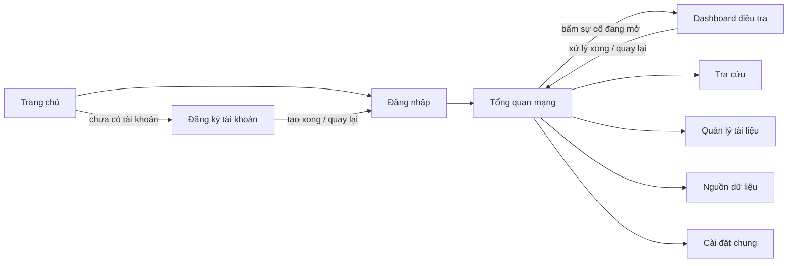

# Bản đồ trang ứng dụng

Tài liệu liệt kê toàn bộ trang của hệ thống, quy ước điều hướng giữa các trang, và trạng thái thiết kế của từng trang. Dashboard điều tra sự cố là một trang trong số này — vì phức tạp nhất nên có thư mục thiết kế riêng (`dashboard-page-stylebook/`, ch0–ch5). Từ ngày 10-11, mỗi trang được đặc tả bằng **một trang thiết kế tương tác** trong thư mục `app-pages/` (miniature của trang ở giữa, hai sidebar card giải thích xung quanh); tài liệu này giữ vai trò **bản đồ + tóm tắt**, trỏ về trang tương tác của từng trang.

# Mục lục

- [I. Nguyên tắc](#i-nguyên-tắc)
- [II. Sơ đồ điều hướng](#ii-sơ-đồ-điều-hướng)
- [III. Bảng tổng hợp](#iii-bảng-tổng-hợp)
- [IV. Đặc tả từng trang](#iv-đặc-tả-từng-trang)
  - [1. Trang chủ](#1-trang-chủ)
  - [2. Đăng nhập](#2-đăng-nhập)
  - [3. Đăng ký tài khoản](#3-đăng-ký-tài-khoản)
  - [4. Tổng quan mạng](#4-tổng-quan-mạng)
  - [5. Dashboard điều tra sự cố](#5-dashboard-điều-tra-sự-cố)
  - [6. Tra cứu thiết bị, liên kết, dịch vụ](#6-tra-cứu-thiết-bị-liên-kết-dịch-vụ)
  - [7. Quản lý tài liệu](#7-quản-lý-tài-liệu)
  - [8. Cấu hình nguồn dữ liệu](#8-cấu-hình-nguồn-dữ-liệu)
  - [9. Cài đặt chung](#9-cài-đặt-chung)
- [V. Trang không làm](#v-trang-không-làm)

# I. Nguyên tắc

- Ứng dụng gồm **9 trang** (Đăng ký thêm 11-11; Trang chủ + Tổng quan mạng thêm 12-11; Nguồn dữ liệu + Cài đặt thêm 12-11). Dashboard điều tra sự cố là trang trung tâm và phức tạp nhất; các trang còn lại phục vụ một tác vụ đơn lẻ mỗi trang.
- **Format đặc tả một trang — trang thiết kế tương tác** trong `app-pages/` (một HTML mỗi trang, dùng chung `css/app-pages.css` + `js/app-pages.js`): **miniature của trang (khung thiết kế 1440×900, tự scale lấp vùng giữa) đặt giữa**, hai sidebar card hai bên — trái = **bố cục & vùng**, phải = **tương tác** (liệt kê thao tác của người dùng trên trang); bấm card hoặc vùng trên miniature để soi tương ứng (bấm chốt, Esc hoặc bấm nền bỏ chốt), các nút trạng thái chạy demo ngay trên miniature. **Trang phức tạp** (hiện chỉ Dashboard) tách thư mục thiết kế riêng theo mẫu `dashboard-page-stylebook/`. Nguồn dữ liệu là ứng viên dễ phức tạp hóa nếu yêu cầu mở rộng.
- Dashboard điều tra là **một trang duy nhất** với các trạng thái theo hành trình điều tra (tiếp nhận → điều tra → soi thiết bị → đánh giá ảnh hưởng → xử lý xong). Năm file prototype giai đoạn trong README (01→05) là năm trạng thái của cùng một trang, không phải năm trang riêng.
- Đã thiết kế đủ 9 trang: Dashboard (`dashboard-page-stylebook/` ch0–ch5), Đăng nhập, Đăng ký, Trang chủ, Tổng quan mạng, Tra cứu, Quản lý tài liệu, Nguồn dữ liệu, Cài đặt.
- **Bảng + panel chi tiết** là pattern dùng chung của Tra cứu và Quản lý tài liệu (khối `.vp-thead`/`.vp-trow`/`.vp-chip` chia sẻ trong `css/app-pages.css`) — chip trạng thái một ngôn ngữ trên cả hai trang.
- **Token màu & font dùng chung một nguồn** (`design-tokens.css` đặt cạnh hai thư mục thiết kế, thêm 13-11): cả stylebook dashboard lẫn các trang tương tác đều link cùng một file token — palette giấy/mực, màu nhấn, bộ ba trạng thái (gốc + nền mờ/viền/chữ cho chip & băng), màu canvas topology, site/tier, và hai họ font. Sửa giá trị chỉ tại file này để style không lệch giữa các trang; từng trang chỉ còn CSS bố cục & thành phần riêng. Chrome điều hướng của tài liệu (tab trang, nút trạng thái) theo ngôn ngữ stylebook: nhãn mono, trạng thái chọn nền mực.

# II. Sơ đồ điều hướng

- Chưa đăng nhập: vào **Trang chủ** trước — hai nút dẫn sang Đăng nhập và Đăng ký. Đề xuất: nếu phiên cũ còn hợp lệ, nút chính đổi thành "Tiếp tục phiên làm việc" vào thẳng Tổng quan.
- Sau đăng nhập, trang mặc định là **Tổng quan mạng**; nếu có sự cố đang được xử lý dở, hệ thống hỏi "tiếp tục điều tra INC-xx?" và vào thẳng Dashboard nếu đồng ý.
- Chưa có tài khoản: link "Đăng ký" dưới form Đăng nhập mở trang Đăng ký; sau khi tạo tài khoản (kích hoạt qua email — đề xuất), quay lại Đăng nhập.
- **Thanh điều hướng chính nằm trong topbar, hiện ở mọi trang sau đăng nhập**: Tổng quan · Điều tra · Tra cứu · Tài liệu · Nguồn dữ liệu · Cài đặt. Trang chủ (chưa đăng nhập) có thanh riêng: chỉ brand + hai nút Đăng nhập/Tạo tài khoản. Sơ đồ trên chỉ vẽ luồng chính; thực tế từ bất kỳ trang nào cũng sang được trang bất kỳ khác qua topbar.
- Khi ở Dashboard, topbar giữ bố cục ch0 (brand + chip sự cố INC-07 và trạng thái xử lý); **đề xuất**: các tab điều hướng đặt cạnh brand, chip sự cố đứng sau tab Điều tra đang ở trạng thái active. Chi tiết phối hợp này cần chốt khi dựng ch0 lại.
- Đi sâu từ Tra cứu: chọn một thiết bị → nút "xem trong topology" mở Dashboard (hoặc Tổng quan nếu không có sự cố nào đang mở) với thiết bị đó ở trạng thái được chọn.

# III. Bảng tổng hợp

| # | Trang | Mục đích | Ai dùng | Độ phức tạp | Trạng thái thiết kế |
|---|-------|----------|---------|-------------|---------------------|
| 1 | Trang chủ | Cổng vào cho người dùng chưa đăng nhập — giới thiệu ngắn, dẫn sang Đăng nhập/Đăng ký | Mọi người dùng | Đơn giản | Khung đề xuất — [`app-pages/landing.html`](app-pages/landing.html) |
| 2 | Đăng nhập | Xác thực vào hệ thống | Mọi người dùng | Đơn giản | Khung đề xuất — [`app-pages/login.html`](app-pages/login.html) |
| 3 | Đăng ký tài khoản | Tự đăng ký tài khoản kỹ sư vận hành | Người dùng mới | Đơn giản | Khung đề xuất — [`app-pages/signup.html`](app-pages/signup.html) |
| 4 | Tổng quan mạng | Nhìn nhanh sức khỏe mạng và chọn sự cố để điều tra | Kỹ sư, quản lý vận hành | Trung bình | Khung đề xuất — [`app-pages/overview.html`](app-pages/overview.html) |
| 5 | Dashboard điều tra | Theo dõi, khoanh vùng và xử lý một sự cố trên topology | Kỹ sư trực | Cao | **Đã thiết kế** — `dashboard-page-stylebook/` ch0–ch5 |
| 6 | Tra cứu | Tra cứu thiết bị, liên kết, dịch vụ không gắn với sự cố đang mở | Kỹ sư | Trung bình | Khung đề xuất — [`app-pages/lookup.html`](app-pages/lookup.html) |
| 7 | Quản lý tài liệu | Nạp và quản lý tài liệu kỹ thuật, nghiệp vụ cho AI | Kỹ sư, người phụ trách nội dung | Đơn giản | Khung đề xuất — [`app-pages/documents.html`](app-pages/documents.html) |
| 8 | Nguồn dữ liệu | Cấu hình hệ thống nguồn bên thứ ba và mapping dữ liệu | Quản trị hệ thống | Trung bình | Khung đề xuất — [`app-pages/sources.html`](app-pages/sources.html) |
| 9 | Cài đặt chung | Tùy chỉnh giao diện toàn ứng dụng, lưu vĩnh viễn | Mọi người dùng | Đơn giản | Khung đề xuất — [`app-pages/settings.html`](app-pages/settings.html) |

# IV. Đặc tả từng trang

Mỗi mục dưới đây chỉ là tóm tắt — đặc tả đầy đủ nằm trong trang tương tác tương ứng của thư mục `app-pages/`.

## 1. Trang chủ

**Đã đặc tả: [`app-pages/landing.html`](app-pages/landing.html)** — miniature trang chủ ở giữa (5 vùng: thanh trên cùng, thông điệp chính, hai nút hành động, ba khối năng lực, chân trang), hai sidebar giải thích, demo 2 trạng thái (mặc định, có phiên cũ).

Tóm tắt thiết kế: lớp giới thiệu mỏng nhẹ — thanh trên cùng chỉ có brand + hai nút xác thực; một thông điệp nói rõ công cụ làm gì; ba khối năng lực (TOPOLOGY, ĐIỀU TRA, TRA CỬU) trỏ thẳng ba vùng cốt lõi của app thay vì liệt kê tính năng chung chung. Đề xuất chờ gật: nút "Tạo tài khoản" (đường phụ, giống link Đăng ký ở trang Đăng nhập) và trạng thái "có phiên cũ" — nút chính đổi thành "Tiếp tục phiên làm việc" vào thẳng Tổng quan.

## 2. Đăng nhập

**Đã đặc tả: [`app-pages/login.html`](app-pages/login.html)** — miniature trang đăng nhập ở giữa (6 vùng: brand, thẻ, hai trường + nút chính, nút SSO, liên kết sang Đăng ký, chân trang), hai sidebar giải thích, demo 4 trạng thái (mặc định, lỗi, đang xử lý, thành công).

Tóm tắt thiết kế: một thẻ đăng nhập duy nhất giữa nền chấm bi; brand góc trên trái giống hệt topbar Dashboard; form nội bộ là đường chính, nút SSO là đường phụ (**đề xuất chờ gật**); lỗi báo inline trong thẻ, không alert; dòng "Chưa có tài khoản? Đăng ký" dẫn sang trang Đăng ký (đề xuất); chân trang ghi phiên bản + môi trường (đề xuất). Sau đăng nhập vào Tổng quan mạng, hoặc thẳng Dashboard nếu có sự cố đang xử lý dở (quy ước ở mục II).

## 3. Đăng ký tài khoản

**Đã đặc tả: [`app-pages/signup.html`](app-pages/signup.html)** — miniature trang đăng ký ở giữa (5 vùng: brand, thẻ, bốn trường, nút chính + đường về Đăng nhập, chân trang), hai sidebar giải thích, demo 4 trạng thái (mặc định, mật khẩu không khớp, email đã tồn tại, thành công).

Tóm tắt thiết kế: cùng vỏ ngoài với Đăng nhập (brand góc trái, một thẻ giữa nền chấm bi, chân trang môi trường); bốn trường — họ và tên, email công ty, mật khẩu kèm gợi ý "tối thiểu 8 ký tự", xác nhận mật khẩu; lỗi báo inline đúng vị trí (dưới trường, băng trên form), không alert. Sau tạo tài khoản: gửi email kích hoạt rồi về Đăng nhập (**luồng đề xuất chờ gật** — phương án khác: chờ quản trị duyệt).

## 4. Tổng quan mạng

**Đã đặc tả: [`app-pages/overview.html`](app-pages/overview.html)** — miniature trang tổng quan ở giữa (6 vùng: thanh điều hướng ứng dụng, tiêu đề + thời điểm dữ liệu, bốn thẻ chỉ số, sự cố đang mở, đã xử lý gần đây, chân trang), hai sidebar giải thích, demo 4 trạng thái (mặc định, có phiên dở, đang tải, mới thiết lập).

Tóm tắt thiết kế: trả lời "mạng đang thế nào, việc gì cần xử lý trước" trong một màn hình — bốn thẻ chỉ số sức khỏe trên cùng (nút hoạt động, cảnh báo đang mở, sự cố đang xử lý, cổng mất kết nối, mỗi thẻ kèm dòng phụ chỉ đúng đối tượng), danh sách sự cố đang mở sắp theo mức độ ưu tiên với nút "Mở Dashboard" (lối vào chính của Dashboard), và sự cố đã xử lý gần đây kèm thời gian khôi phục. Nếu còn phiên điều tra dở, băng trên cùng hỏi "tiếp tục điều tra INC-xx?" (quy ước ở mục II). Khác Dashboard: Tổng quan trả lời "chọn việc gì" khi chưa có ngữ cảnh sự cố; Dashboard trả lời "sự cố này là gì" khi đã có.

## 5. Dashboard điều tra sự cố

- Trang trung tâm, **đã thiết kế đầy đủ trong `dashboard-page-stylebook/` (ch0–ch5)** — tài liệu này không đặc tả lại.
- Bốn vùng: topbar (chip sự cố + trạng thái), sidebar trái (tìm kiếm, timeline cảnh báo, giả thuyết AI, cài đặt hiển thị — ch4), canvas topology (ch1–ch3), Inspector phải (ch5).
- Các trạng thái hành trình: tiếp nhận → điều tra giả thuyết → soi thiết bị, cổng → đánh giá ảnh hưởng dịch vụ → xác nhận nguyên nhân, xử lý xong — tất cả diễn ra trên một trang.

## 6. Tra cứu thiết bị, liên kết, dịch vụ

**Đã đặc tả: [`app-pages/lookup.html`](app-pages/lookup.html)** — miniature trang tra cứu ở giữa (6 vùng: thanh điều hướng, tìm kiếm + bộ lọc, tab theo loại, bảng tài nguyên, panel chi tiết, chân trang), hai sidebar giải thích, demo 3 trạng thái (mặc định, chưa chọn, không có kết quả).

Tóm tắt thiết kế: tra cứu tài nguyên khi không có sự cố đang mở — ô tìm kiếm lớn (lọc ngay khi gõ, không nút "Tìm") + ba bộ lọc (Lớp, Khu vực, Trạng thái) và tab theo loại kèm số lượng (Thiết bị, Liên kết, Dịch vụ) đứng trên bảng. Chọn một dòng → panel chi tiết bên phải dùng ngôn ngữ hiển thị giống Inspector (ch5) để nhất quán; nút chính "Xem trong topology" mở Dashboard với đối tượng được chọn, hoặc về Tổng quan nếu không có sự cố đang mở (quy ước ở mục II).

## 7. Quản lý tài liệu

**Đã đặc tả: [`app-pages/documents.html`](app-pages/documents.html)** — miniature trang quản lý tài liệu ở giữa (5 vùng: thanh điều hướng, tiêu đề + nút tải lên, bảng tài liệu, xem trước, chân trang), hai sidebar giải thích, demo 3 trạng thái (mặc định, chưa chọn, vừa tải lên).

Tóm tắt thiết kế: nơi kỹ sư nạp tài liệu kỹ thuật, nghiệp vụ cho AI trích dẫn khi điều tra (kho tài liệu trong kiến trúc đề xuất). Bảng liệt kê tên, nguồn, loại, thời điểm cập nhật và **trạng thái lập chỉ mục** — SẴN SÀNG (AI trích dẫn được), ĐANG LẬP CHỈ MỤC, LỖI kèm lý do (tài liệu lỗi không bị AI trích dẫn để tránh dẫn chứng sai). Tải lên xong hiện băng xác nhận + dòng mới với chip "đang lập chỉ mục". Chọn một dòng → xem trước nội dung + meta nguồn + nút thay thế tệp (bản cũ giữ lại — đề xuất). Tài liệu AI trích dẫn trong Dashboard (khối wiki Inspector) phải tìm được về đây theo nguồn. Bố cục bảng + panel dùng chung pattern với Tra cứu.

## 8. Cấu hình nguồn dữ liệu

**Đã đặc tả: [`app-pages/sources.html`](app-pages/sources.html)** — miniature trang nguồn dữ liệu ở giữa (6 vùng: thanh điều hướng, tiêu đề + nút thêm nguồn, danh sách nguồn, cấu hình nguồn đang chọn, lịch sử đồng bộ, chân trang), hai sidebar giải thích, demo 4 trạng thái (mặc định, nguồn hàng đợi, lỗi đồng bộ, đang đồng bộ lại).

Tóm tắt thiết kế: trang quản trị kết nối hệ thống nguồn bên thứ ba (mô-đun tích hợp trong kiến trúc đề xuất). Danh sách nguồn hiển thị tên, kiểu kết nối (REST polling hoặc message queue) và trạng thái lần đồng bộ gần nhất ngay trên dòng — lỗi kèm lý do, không cần mở vào mới biết nguồn nào hỏng. Chọn một nguồn → panel phải đổi sang cấu hình tương ứng: địa chỉ, phương thức đồng bộ và bảng ánh xạ trường dữ liệu vào mô hình của hệ thống (trường chưa ánh xạ cảnh báo vàng). Lịch sử đồng bộ của nguồn đang chọn kèm nút "Đồng bộ lại từ đầu"; nguồn message queue nhận luồng liên tục nên không có lịch sử poll. Thay đổi chỉ có hiệu lực sau khi bấm "Lưu thay đổi". Dữ liệu chỉ đồng bộ một chiều — trang này không gửi ngược gì về hệ thống nguồn.

## 9. Cài đặt chung

**Đã đặc tả: [`app-pages/settings.html`](app-pages/settings.html)** — miniature trang cài đặt ở giữa (6 vùng: thanh điều hướng, tiêu đề, khối chủ đề, khối hiển thị mặc định, khối khôi phục mặc định, chân trang), hai sidebar giải thích, demo 4 trạng thái (mặc định, chủ đề tối, chưa lưu, đã lưu).

Tóm tắt thiết kế: nơi lưu tùy chọn giao diện toàn ứng dụng — khối chủ đề (Sáng / Tối / Theo hệ thống) áp dụng ngay mọi trang (trạng thái "Chủ đề tối" đổi màu cả miniature); khối hiển thị mặc định là bản gốc của phím chỉnh nhanh mục 4.4 trong Dashboard — 4.4 tác động phiên hiện tại, trang này là giá trị mặc định khi mở Dashboard mới, kèm tùy chọn băng hỏi tiếp tục phiên dở ở Tổng quan; nút "Khôi phục mặc định" đưa mọi tùy chọn về giá trị ban đầu. Đáp ứng tiêu chí khả năng sử dụng trong proposal: tùy chọn lưu theo tài khoản, khôi phục được về mặc định. Đề xuất chờ gật: cơ chế lưu rõ ràng với băng cảnh báo "chưa lưu".

# V. Trang không làm

- **Danh sách cảnh báo riêng**: timeline cảnh báo trong sidebar trái Dashboard (4.2) và danh sách ở Tổng quan mạng đã phủ nhu cầu; tách trang riêng chỉ khi cần lọc sâu quá mức của hai nơi trên.
- **Quản lý người dùng, phân quyền**: ngoài phạm vi proposal.
- **Trang thao tác trên thiết bị (cấu hình, khắc phục)**: hệ thống không trực tiếp cấu hình thiết bị hay thực thi lệnh trên hạ tầng — ngoài phạm vi.
- **Wiki tài liệu riêng**: tài liệu nằm ở Quản lý tài liệu; trong Dashboard chỉ có khối trích dẫn gắn với cảnh báo.
