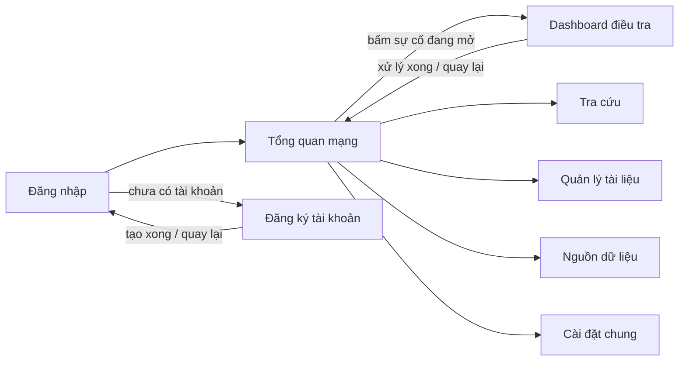

# Bản đồ trang ứng dụng

Tài liệu liệt kê toàn bộ trang của hệ thống, quy ước điều hướng giữa các trang, và trạng thái thiết kế của từng trang. Dashboard điều tra sự cố là một trang trong số này — vì phức tạp nhất nên có thư mục thiết kế riêng (`dashboard-page-stylebook/`, ch0–ch5). Từ ngày 10-11, mỗi trang được đặc tả bằng **một trang thiết kế tương tác** trong thư mục `app-pages/` (miniature của trang ở giữa, hai sidebar card giải thích xung quanh); tài liệu này giữ vai trò **bản đồ + tóm tắt**, trỏ về trang tương tác của từng trang.

# Mục lục

- [I. Nguyên tắc](#i-nguyên-tắc)
- [II. Sơ đồ điều hướng](#ii-sơ-đồ-điều-hướng)
- [III. Bảng tổng hợp](#iii-bảng-tổng-hợp)
- [IV. Đặc tả từng trang](#iv-đặc-tả-từng-trang)
  - [1. Đăng nhập](#1-đăng-nhập)
  - [2. Đăng ký tài khoản](#2-đăng-ký-tài-khoản)
  - [3. Tổng quan mạng](#3-tổng-quan-mạng)
  - [4. Dashboard điều tra sự cố](#4-dashboard-điều-tra-sự-cố)
  - [5. Tra cứu thiết bị, liên kết, dịch vụ](#5-tra-cứu-thiết-bị-liên-kết-dịch-vụ)
  - [6. Quản lý tài liệu](#6-quản-lý-tài-liệu)
  - [7. Cấu hình nguồn dữ liệu](#7-cấu-hình-nguồn-dữ-liệu)
  - [8. Cài đặt chung](#8-cài-đặt-chung)
- [V. Trang không làm](#v-trang-không-làm)

# I. Nguyên tắc

- Ứng dụng gồm **8 trang** (Đăng ký thêm 11-11). Dashboard điều tra sự cố là trang trung tâm và phức tạp nhất; các trang còn lại phục vụ một tác vụ đơn lẻ mỗi trang.
- **Format đặc tả một trang — trang thiết kế tương tác** trong `app-pages/` (một HTML mỗi trang, dùng chung `css/app-pages.css` + `js/app-pages.js`): **miniature của trang (khung thiết kế 1440×900, tự scale lấp vùng giữa) đặt giữa**, hai sidebar card hai bên — trái = **bố cục & vùng**, phải = **tương tác** (liệt kê thao tác của người dùng trên trang); bấm card hoặc vùng trên miniature để soi tương ứng (bấm chốt, Esc hoặc bấm nền bỏ chốt), các nút trạng thái chạy demo ngay trên miniature. **Trang phức tạp** (hiện chỉ Dashboard) tách thư mục thiết kế riêng theo mẫu `dashboard-page-stylebook/`. Hai ứng viên dễ phức tạp hóa tiếp theo là Tổng quan mạng và Tra cứu.
- Dashboard điều tra là **một trang duy nhất** với các trạng thái theo hành trình điều tra (tiếp nhận → điều tra → soi thiết bị → đánh giá ảnh hưởng → xử lý xong). Năm file prototype giai đoạn trong README (01→05) là năm trạng thái của cùng một trang, không phải năm trang riêng.
- Thứ tự ưu tiên thiết kế: Dashboard (đã xong, `dashboard-page-stylebook/` ch0–ch5) → Tổng quan mạng → Tra cứu → còn lại theo nhu cầu.

# II. Sơ đồ điều hướng

- Sau đăng nhập, trang mặc định là **Tổng quan mạng**; nếu có sự cố đang được xử lý dở, hệ thống hỏi "tiếp tục điều tra INC-xx?" và vào thẳng Dashboard nếu đồng ý.
- Chưa có tài khoản: link "Đăng ký" dưới form Đăng nhập mở trang Đăng ký; sau khi tạo tài khoản (kích hoạt qua email — đề xuất), quay lại Đăng nhập.
- **Thanh điều hướng chính nằm trong topbar, hiện ở mọi trang**: Tổng quan · Điều tra · Tra cứu · Tài liệu · Nguồn dữ liệu · Cài đặt. Sơ đồ trên chỉ vẽ luồng chính; thực tế từ bất kỳ trang nào cũng sang được trang bất kỳ khác qua topbar.
- Khi ở Dashboard, topbar giữ bố cục ch0 (brand + chip sự cố INC-07 và trạng thái xử lý); **đề xuất**: các tab điều hướng đặt cạnh brand, chip sự cố đứng sau tab Điều tra đang ở trạng thái active. Chi tiết phối hợp này cần chốt khi dựng ch0 lại.
- Đi sâu từ Tra cứu: chọn một thiết bị → nút "xem trong topology" mở Dashboard (hoặc Tổng quan nếu không có sự cố nào đang mở) với thiết bị đó ở trạng thái được chọn.

# III. Bảng tổng hợp

| # | Trang | Mục đích | Ai dùng | Độ phức tạp | Trạng thái thiết kế |
|---|-------|----------|---------|-------------|---------------------|
| 1 | Đăng nhập | Xác thực vào hệ thống | Mọi người dùng | Đơn giản | Khung đề xuất — [`app-pages/login.html`](app-pages/login.html) |
| 2 | Đăng ký tài khoản | Tự đăng ký tài khoản kỹ sư vận hành | Người dùng mới | Đơn giản | Khung đề xuất — [`app-pages/signup.html`](app-pages/signup.html) |
| 3 | Tổng quan mạng | Nhìn nhanh sức khỏe mạng và chọn sự cố để điều tra | Kỹ sư, quản lý vận hành | Trung bình | Chưa thiết kế — đề xuất |
| 4 | Dashboard điều tra | Theo dõi, khoanh vùng và xử lý một sự cố trên topology | Kỹ sư trực | Cao | **Đã thiết kế** — `dashboard-page-stylebook/` ch0–ch5 |
| 5 | Tra cứu | Tra cứu thiết bị, liên kết, dịch vụ không gắn với sự cố đang mở | Kỹ sư | Trung bình | Chưa thiết kế |
| 6 | Quản lý tài liệu | Nạp và quản lý tài liệu kỹ thuật, nghiệp vụ cho AI | Kỹ sư, người phụ trách nội dung | Đơn giản | Chưa thiết kế |
| 7 | Nguồn dữ liệu | Cấu hình hệ thống nguồn bên thứ ba và mapping dữ liệu | Quản trị hệ thống | Trung bình | Chưa thiết kế |
| 8 | Cài đặt chung | Tùy chỉnh giao diện toàn ứng dụng, lưu vĩnh viễn | Mọi người dùng | Đơn giản | Chưa thiết kế |

# IV. Đặc tả từng trang

Mỗi mục dưới đây chỉ là tóm tắt — đặc tả đầy đủ nằm trong trang tương tác tương ứng của thư mục `app-pages/`.

## 1. Đăng nhập

**Đã đặc tả: [`app-pages/login.html`](app-pages/login.html)** — miniature trang đăng nhập ở giữa (6 vùng: brand, thẻ, hai trường + nút chính, nút SSO, liên kết sang Đăng ký, chân trang), hai sidebar giải thích, demo 4 trạng thái (mặc định, lỗi, đang xử lý, thành công).

Tóm tắt thiết kế: một thẻ đăng nhập duy nhất giữa nền chấm bi; brand góc trên trái giống hệt topbar Dashboard; form nội bộ là đường chính, nút SSO là đường phụ (**đề xuất chờ gật**); lỗi báo inline trong thẻ, không alert; dòng "Chưa có tài khoản? Đăng ký" dẫn sang trang Đăng ký (đề xuất); chân trang ghi phiên bản + môi trường (đề xuất). Sau đăng nhập vào Tổng quan mạng, hoặc thẳng Dashboard nếu có sự cố đang xử lý dở (quy ước ở mục II).

## 2. Đăng ký tài khoản

**Đã đặc tả: [`app-pages/signup.html`](app-pages/signup.html)** — miniature trang đăng ký ở giữa (5 vùng: brand, thẻ, bốn trường, nút chính + đường về Đăng nhập, chân trang), hai sidebar giải thích, demo 4 trạng thái (mặc định, mật khẩu không khớp, email đã tồn tại, thành công).

Tóm tắt thiết kế: cùng vỏ ngoài với Đăng nhập (brand góc trái, một thẻ giữa nền chấm bi, chân trang môi trường); bốn trường — họ và tên, email công ty, mật khẩu kèm gợi ý "tối thiểu 8 ký tự", xác nhận mật khẩu; lỗi báo inline đúng vị trí (dưới trường, băng trên form), không alert. Sau tạo tài khoản: gửi email kích hoạt rồi về Đăng nhập (**luồng đề xuất chờ gật** — phương án khác: chờ quản trị duyệt).

## 3. Tổng quan mạng

- **Mục đích**: trả lời "mạng đang thế nào, việc gì cần xử lý trước" trong một màn hình không chọn trước sự cố nào.
- **Vùng chính**:
  - Hàng chỉ số sức khỏe: số thiết bị gặp sự cố theo mức độ, số sự cố đang mở, cảnh báo mới nhất.
  - Danh sách sự cố đang mở, sắp theo mức độ ưu tiên — bấm một sự cố mở Dashboard với sự cố đó (đây là lối vào chính của Dashboard).
  - Sự cố đã xử lý gần đây, kèm thời gian khôi phục.
- Trang này khác Dashboard thế nào: Tổng quan trả lời "chọn việc gì" khi chưa có ngữ cảnh sự cố; Dashboard trả lời "sự cố này là gì" khi đã có.

## 4. Dashboard điều tra sự cố

- Trang trung tâm, **đã thiết kế đầy đủ trong `dashboard-page-stylebook/` (ch0–ch5)** — tài liệu này không đặc tả lại.
- Bốn vùng: topbar (chip sự cố + trạng thái), sidebar trái (tìm kiếm, timeline cảnh báo, giả thuyết AI, cài đặt hiển thị — ch4), canvas topology (ch1–ch3), Inspector phải (ch5).
- Các trạng thái hành trình: tiếp nhận → điều tra giả thuyết → soi thiết bị, cổng → đánh giá ảnh hưởng dịch vụ → xác nhận nguyên nhân, xử lý xong — tất cả diễn ra trên một trang.

## 5. Tra cứu thiết bị, liên kết, dịch vụ

- **Mục đích**: tra cứu tài nguyên khi không có sự cố đang mở — kiểm tra một thiết bị, xem một liên kết thuộc tuyến nào, một dịch vụ phụ thuộc những gì.
- **Vùng chính**:
  - Bảng tài nguyên có tab theo loại (thiết bị, liên kết, dịch vụ), tìm kiếm và lọc theo lớp, khu vực, trạng thái.
  - Chọn một dòng → panel chi tiết dùng ngôn ngữ hiển thị giống Inspector (ch5) để nhất quán.
  - Hành động "xem trong topology" mở Dashboard với đối tượng được chọn (quy ước ở mục II).

## 6. Quản lý tài liệu

- **Mục đích**: nơi kỹ sư nạp tài liệu kỹ thuật, nghiệp vụ để AI trích dẫn khi điều tra (kho tài liệu trong kiến trúc đề xuất).
- **Vùng chính**:
  - Bảng tài liệu: tên, nguồn, loại, thời điểm cập nhật, trạng thái lập chỉ mục (đã sẵn sàng cho AI tra cứu hay chưa).
  - Tải lên, thay thế, xem trước nội dung.
  - Tài liệu được AI trích dẫn trong Dashboard (khối wiki trong Inspector) phải tìm được về đây theo nguồn.

## 7. Cấu hình nguồn dữ liệu

- **Mục đích**: trang quản trị để kết nối hệ thống nguồn bên thứ ba và quy định cách ánh xạ trường dữ liệu (mô-đun tích hợp trong kiến trúc đề xuất).
- **Vùng chính**:
  - Danh sách nguồn: tên, kiểu kết nối (REST hoặc message queue), trạng thái lần đồng bộ gần nhất, lỗi nếu có.
  - Cấu hình một nguồn: địa chỉ, phương thức đồng bộ (polling theo chu kỳ hoặc messaging), ánh xạ trường dữ liệu vào mô hình của hệ thống.
  - Lịch sử đồng bộ và nút đồng bộ lại từ đầu.
- Dữ liệu chỉ đồng bộ một chiều — trang này không gửi ngược gì về hệ thống nguồn.

## 8. Cài đặt chung

- **Mục đích**: nơi lưu tùy chọn giao diện toàn ứng dụng (tiêu chí khả năng sử dụng trong proposal: tùy chọn được lưu lại và khôi phục được về mặc định).
- **Vùng chính**: giao diện sáng/tối; hiển thị và cách hiển thị mặc định; nút khôi phục mặc định.
- Quan hệ với mục 4.4 trong Dashboard: mục 4.4 là phím chỉnh nhanh cho riêng Dashboard; trang này là nơi quản lý toàn ứng dụng và là chỗ khôi phục mặc định.

# V. Trang không làm

- **Landing page giới thiệu**: hệ thống là công cụ nội bộ cho kỹ sư — trang vào là Đăng nhập, không cần trang marketing.
- **Danh sách cảnh báo riêng**: timeline cảnh báo trong sidebar trái Dashboard (4.2) và danh sách ở Tổng quan mạng đã phủ nhu cầu; tách trang riêng chỉ khi cần lọc sâu quá mức của hai nơi trên.
- **Quản lý người dùng, phân quyền**: ngoài phạm vi proposal.
- **Trang thao tác trên thiết bị (cấu hình, khắc phục)**: hệ thống không trực tiếp cấu hình thiết bị hay thực thi lệnh trên hạ tầng — ngoài phạm vi.
- **Wiki tài liệu riêng**: tài liệu nằm ở Quản lý tài liệu; trong Dashboard chỉ có khối trích dẫn gắn với cảnh báo.
