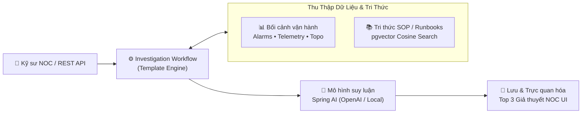
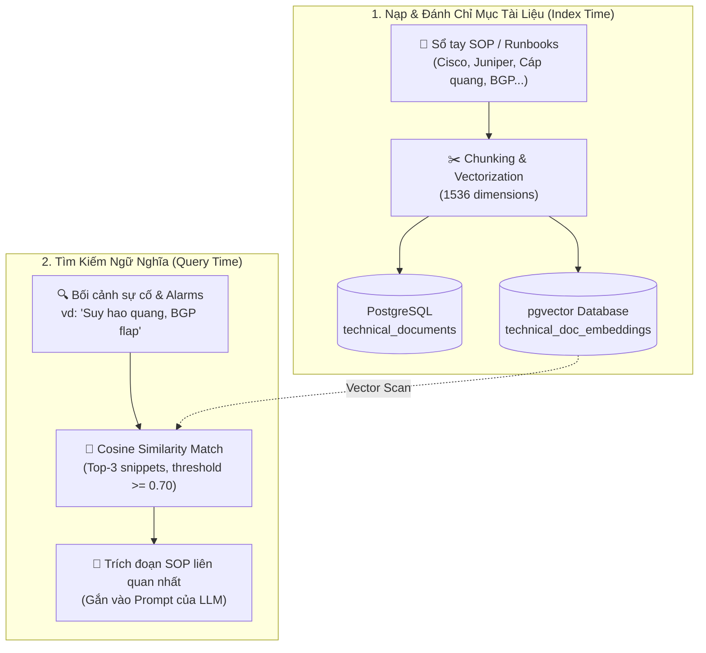
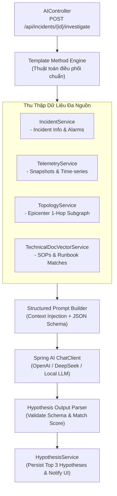
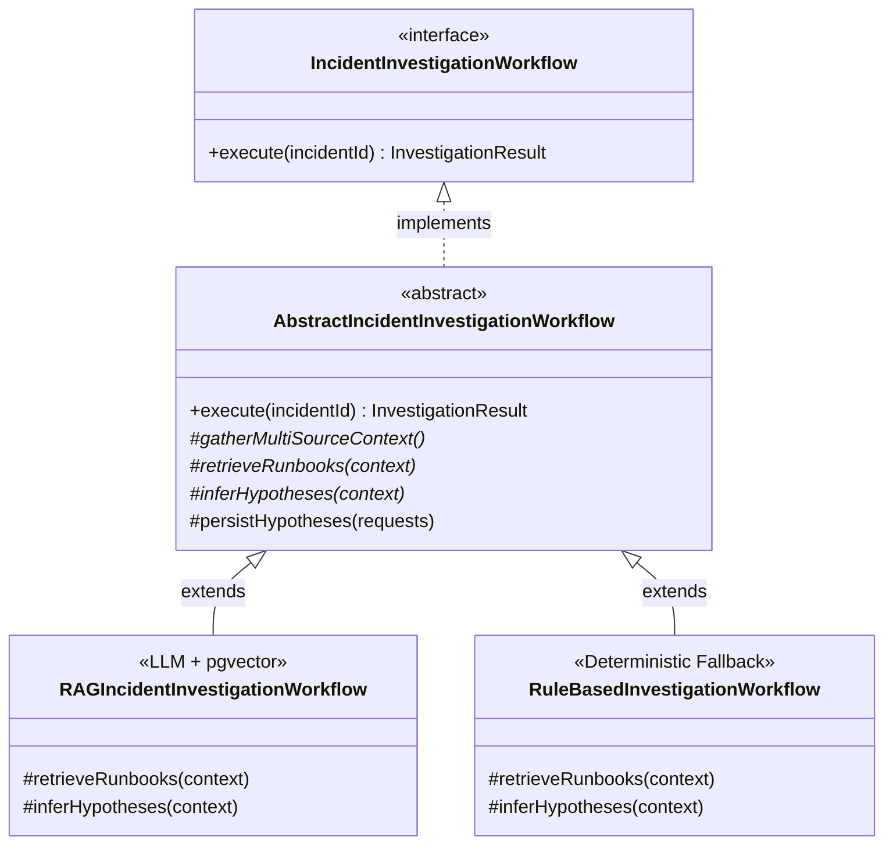
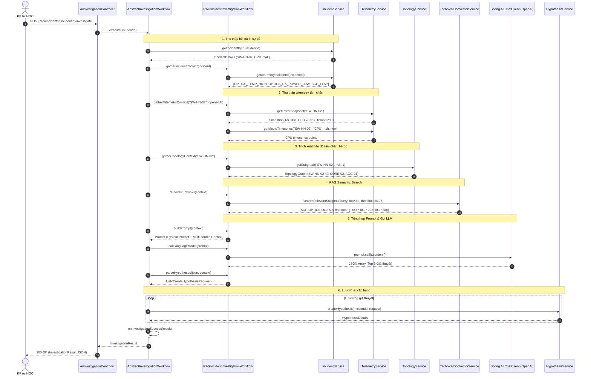

# Thiết Kế Chi Tiết: Module RAG & AI Root Cause Analysis (Tuần 7)

> **Dự án:** Hệ thống Hỗ trợ Điều tra Sự cố Mạng với AI (GR2 — NOC Topology Investigation System with AI)  
> **Thư mục tài liệu:** `docs/week07-ai-design/`  
> **Package mục tiêu:** `com.gr2.noc.rag` và `com.gr2.noc.ai`  
> **Mô hình thiết kế lõi:** **Template Method Design Pattern** kết hợp **Retrieval-Augmented Generation (RAG)** và **Spring AI**

---

## 1. Tổng Quan & Mục Tiêu Kỹ Thuật

Trong vận hành trung tâm NOC, khi một sự cố nghiêm trọng xảy ra (ví dụ: `INC-2026-0915: Suy hao quang học và BGP Flapping`), kỹ sư thường mất từ 15–45 phút để thủ công đối chiếu các nguồn dữ liệu rời rạc:
- Tra cứu danh sách cảnh báo (*Alarms*).
- Kiểm tra các biểu đồ tải và tham số vật lý (*Telemetry: CPU, RAM, $P_{rx}/P_{tx}$ dBm*).
- Xem xét bản đồ phân tầng mạng (*Topology: Các cổng kết nối, láng giềng $1$-hop*).
- Tra cứu sổ tay vận hành tiêu chuẩn (*Standard Operating Procedures - SOP / Runbooks*).

**Mục tiêu của Module AI & RAG:**
1. **Tự động hóa luồng điều tra nguyên nhân gốc rễ (Root Cause Analysis - RCA):** Thu thập toàn diện dữ liệu đa nguồn chỉ trong một quy trình thống nhất.
2. **Tri thức hóa tài liệu vận hành với pgvector:** Đánh chỉ mục và tìm kiếm ngữ nghĩa (*Semantic Search*) các quy trình SOP và tài liệu kỹ thuật từ nhà sản xuất (Cisco, Juniper, Nokia).
3. **Áp dụng Template Method Pattern:** Đóng gói khung quy trình phân tích thành một thuật toán chuẩn mực, tách biệt giữa khung điều phối bất biến và các bước hiện thực hóa cụ thể (hỗ trợ cả mô hình LLM trực tuyến lẫn cơ chế Rule-based offline dự phòng).
4. **Suy luận khách quan, chống ảo giác (Anti-Hallucination):** Ràng buộc LLM chỉ được đưa ra giả thuyết khi có bằng chứng thực tế từ Alarms, Telemetry hoặc Topo, kèm theo mức độ khớp (*Match Score %*) và câu lệnh CLI kiểm tra nhanh (*Quick Verification CLI*).

---

## 2. Kiến Trúc Hệ Thống & Sơ Đồ Thành Phần

Để kiến trúc trực quan, dễ theo dõi và tránh hiện tượng sơ đồ quá lớn gây khó đọc trên các màn hình chuẩn, kiến trúc hệ thống được phân tách thành 3 góc nhìn bổ trợ:

---

### 2.1. Sơ Đồ Luồng Tổng Thể (End-to-End Pipeline)

Mô tả luồng dữ liệu cấp cao từ khi kỹ sư kích hoạt điều tra đến khi xuất bản các giả thuyết lên Dashboard:



---

### 2.2. Phân Hệ Tri Thức Vận Hành & RAG (Knowledge Base & pgvector)

Mô tả chi tiết quá trình nạp tài liệu kỹ thuật (*Index Time*) và cơ chế tìm kiếm tương đồng ngữ nghĩa (*Query Time*):



---

### 2.3. Phân Hệ Điều Phối & Suy Luận AI (Template Engine & Inference)

Mô tả chi tiết luồng xử lý nội bộ tại thời điểm chạy (*Runtime*): gom dữ liệu từ 4 module, xây dựng prompt, gọi LLM và lưu trữ kết quả:



---

## 3. Thiết Kế Mẫu Thiết Kế Template Method (Template Method Pattern Design)

### 3.1. Lý do lựa chọn Template Method Pattern
Quy trình điều tra sự cố mạng luôn tuân thủ một chuỗi các bước logic bất biến trong nghiệp vụ NOC:
1. **Xác thực sự cố** $\rightarrow$ 2. **Thu thập cảnh báo** $\rightarrow$ 3. **Thu thập chỉ số đo kiểm** $\rightarrow$ 4. **Trích xuất topo lân cận** $\rightarrow$ 5. **Tìm kiếm SOP liên quan** $\rightarrow$ 6. **Xây dựng prompt/luật** $\rightarrow$ 7. **Suy luận nguyên nhân** $\rightarrow$ 8. **Chuẩn hóa giả thuyết** $\rightarrow$ 9. **Lưu trữ & Xếp hạng** $\rightarrow$ 10. **Ghi log / Thông báo**.

Nếu viết toàn bộ luồng này vào một Service nguyên khối (monolithic service), hệ thống sẽ gặp các hạn chế:
- Khó kiểm thử độc lập (unit test) từng bước thu thập dữ liệu.
- Không thể linh hoạt thay đổi cơ chế suy luận (ví dụ: chuyển từ gọi OpenAI sang DeepSeek hoặc dùng bộ luật Offline Rule-based khi mất mạng Internet).
- Vi phạm nguyên tắc Open/Closed Principle (OCP).

Áp dụng **Template Method Pattern** giải quyết triệt để vấn đề:
- Lớp cha (`AbstractIncidentInvestigationWorkflow`) cố định khung thuật toán trong phương thức `final execute(String incidentId)`.
- Các lớp con (`RAGIncidentInvestigationWorkflow`, `RuleBasedInvestigationWorkflow`) chỉ tập trung hiện thực các bước chuyên biệt (primitive methods).

---

### 3.2. Sơ Đồ Thiết Kế Mẫu Template Method (High-Level Class Diagram)

Sơ đồ tập trung ở mức kiến trúc tổng quan (High-Level) làm nổi bật mẫu thiết kế **Template Method** và nguyên tắc OCP (Open/Closed Principle) mà không bị quá tải bởi các tham số kiểu dữ liệu chi tiết:



> [!NOTE]
> Hai cấu trúc dữ liệu chính phục vụ luồng điều phối:
> - **`InvestigationContext`**: Record đóng gói toàn bộ bối cảnh đầu vào (`incident`, `alarms`, `telemetry`, `topology`, `runbooks`).
> - **`InvestigationResult`**: Record đóng gói đầu ra cuối cùng (`incidentId`, danh sách `hypotheses`, `consultedRunbooks`, `duration`).
>
> *(Chi tiết đầy đủ các trường và chữ ký phương thức được đặc tả tường minh tại Mục 3.3 và Mục 4 bên dưới).*

---

### 3.3. Thuật Toán Cốt Lõi Trong Template Method (`execute`)

Khung xử lý chuẩn được phác thảo trong phương thức `final execute` của lớp cha:

```java
public abstract class AbstractIncidentInvestigationWorkflow implements IncidentInvestigationWorkflow {

    @Override
    public final InvestigationResult execute(String incidentId) {
        Instant startTime = Instant.now();
        try {
            // Bước 1: Xác thực sự cố tồn tại (Concrete method)
            IncidentDetails incident = validateIncident(incidentId);

            // Bước 2: Thu thập các cảnh báo đang kích hoạt (Primitive method)
            List<AlarmDetails> alarms = gatherIncidentContext(incident);

            // Bước 3: Thu thập số liệu đo kiểm hiệu năng tại thiết bị tâm chấn (Primitive method)
            TelemetryContext telemetry = gatherTelemetryContext(
                incident.primaryDeviceId(), 
                incident.openedAt()
            );

            // Bước 4: Trích xuất topo láng giềng 1-hop quanh tâm chấn (Primitive method)
            TopologyGraph topology = gatherTopologyContext(incident.primaryDeviceId());

            // Đóng gói toàn bộ bằng chứng vào InvestigationContext
            InvestigationContext context = new InvestigationContext(
                incident, alarms, telemetry, topology, Collections.emptyList()
            );

            // Bước 5: Truy xuất các tài liệu SOP và Runbook tương đồng (Primitive method)
            List<TechnicalDocSnippet> runbooks = retrieveRunbooks(context);
            context = context.withRunbooks(runbooks);

            // Bước 6: Xây dựng Prompt chuẩn hóa ngữ cảnh (Primitive method)
            Prompt prompt = buildPrompt(context);

            // Bước 7: Thực hiện suy luận (Gọi LLM hoặc bộ luật quy nạp) (Primitive method)
            LLMInvestigationResponse rawResponse = callLanguageModel(prompt);

            // Bước 8: Chuyển đổi phản hồi sang danh sách CreateHypothesisRequest (Primitive method)
            List<CreateHypothesisRequest> hypothesisRequests = parseHypotheses(rawResponse, context);

            // Bước 9: Lưu trữ các giả thuyết vào cơ sở dữ liệu qua HypothesisService (Concrete method)
            List<HypothesisDetails> savedHypotheses = persistHypotheses(incidentId, hypothesisRequests);

            // Bước 10: Xây dựng kết quả tổng hợp
            InvestigationResult result = new InvestigationResult(
                incidentId,
                savedHypotheses,
                runbooks.stream().map(TechnicalDocSnippet::title).toList(),
                Duration.between(startTime, Instant.now()),
                getEngineType()
            );

            // Hook method thông báo thành công
            onInvestigationSuccess(result);
            return result;

        } catch (Exception ex) {
            // Hook method xử lý thất bại
            onInvestigationFailure(incidentId, ex);
            throw ex;
        }
    }
}
```

---

## 4. Trình Tự Thực Thi Thực Tế (Sequence Diagram)

Sơ đồ trình tự mô tả chi tiết tương tác giữa các thành phần khi kỹ sư bấm nút **"AI Chẩn Đoán Sự Cố"**:



---

## 5. Thiết Kế Tầng Tri Thức RAG (`com.gr2.noc.rag`)

### 5.1. Cấu trúc Mô hình Dữ liệu (Entity & Enums)

1. **`DocType` (Enum):**
   - `OPERATION_RUNBOOK`: Hướng dẫn vận hành chuẩn của nhà mạng viễn thông.
   - `VENDOR_SPECIFICATION`: Đặc tả kỹ thuật thiết bị từ nhà cung cấp phần cứng (ngưỡng công suất quang, bảng mã lỗi).
   - `POST_MORTEM_REPORT`: Báo cáo nguyên nhân gốc rễ và bài học từ các sự cố tương tự trong quá khứ.

2. **`TechnicalDocument` (JPA Entity):**
   - `@Id String id`: Mã tài liệu (ví dụ: `SOP-OPTICS-01`).
   - `String title`: Tiêu đề (ví dụ: *"Quy trình xử lý suy hao module quang và mất tín hiệu RX"*).
   - `@Enumerated DocType docType`: Loại tài liệu.
   - `String applicableHardware`: Dòng thiết bị áp dụng (ví dụ: `Cisco ASR 9000, Nexus 9000, Nokia 7750 SR`).
   - `List<String> targetFaultCodes`: Mã cảnh báo liên quan (`OPTICS_RX_POWER_LOW`, `OPTICS_TEMP_HIGH`, `BGP_FLAP`).
   - `String content`: Nội dung toàn văn quy trình xử lý.
   - `Instant updatedAt`: Thời điểm cập nhật.

3. **Cấu hình Bảng Vector `pgvector`:**
   - Tên bảng: `technical_doc_embeddings`
   - Số chiều vector (*Dimensions*): `1536`
   - Thuật toán khoảng cách: `COSINE`
   - Metadata lưu trữ kèm chunk:
     - `documentId`, `chunkIndex`, `title`, `docType`, `applicableFaultCodes`.

### 5.2. Hợp đồng Dịch vụ Vector (`TechnicalDocVectorService`)
```java
public interface TechnicalDocVectorService {

    /**
     * Nạp tài liệu kỹ thuật, tự động chia nhỏ thành các đoạn chunk và đánh chỉ mục embedding lên pgvector.
     */
    void indexDocument(TechnicalDocument document);

    /**
     * Tìm kiếm các đoạn tài liệu có nội dung tương đồng nhất với truy vấn.
     */
    List<TechnicalDocSnippet> searchRelevantSnippets(String query, int topK, double minSimilarityScore);

    /**
     * Xóa chỉ mục của tài liệu theo ID.
     */
    void deleteIndex(String documentId);
}
```

---

## 6. Chiến Lược Xây Dựng Prompt & Cơ Chế Chống Ảo Giác (Anti-Hallucination)

### 6.1. System Prompt (Quy định vai trò & Ràng buộc đạo đức suy luận)
```text
Bạn là Kỹ sư Trưởng L3 phụ trách Trung tâm Điều hành Mạng Viễn thông Quốc gia (NOC Lead Architect).
Nhiệm vụ của bạn là xem xét toàn diện dữ liệu đa nguồn của sự cố mạng viễn thông được cung cấp, đối chiếu với Quy trình vận hành chuẩn (SOP) đính kèm để đưa ra Top 3 giả thuyết nguyên nhân gốc rễ (Root Cause Hypotheses) có cơ sở vững chắc nhất.

CÁC NGUYÊN TẮC SUY LUẬN BẮT BUỘC:
1. KHÔNG ẢO GIÁC: Mọi giả thuyết đưa ra PHẢI có ít nhất 1 bằng chứng xác thực (evidence) được trích xuất trực tiếp từ Alarms, Telemetry hoặc Topo cung cấp. Không được tự suy đoán phần cứng không tồn tại.
2. PHẢN CHỨNG KHÁCH QUAN: Luôn tìm kiếm bằng chứng mâu thuẫn (contradictingEvidence) chứng minh tại sao một số nguyên nhân thông thường lại bị loại trừ (ví dụ: BGP flap nhưng CPU thấp chứng tỏ không phải do treo tiến trình CPU).
3. ĐIỂM KHỚP CHÍNH XÁC (matchScore 0-100%):
   - >= 80%: Khi cả mã lỗi, công suất quang và topo đều chỉ thẳng vào một liên kết cụ thể.
   - 60-79%: Khi lỗi phần cứng hoặc cấu hình có khả năng cao nhưng cần kiểm tra thêm.
   - < 60%: Các nguyên nhân thứ yếu hoặc khả năng hiếm gặp.
4. LỆNH THỰC THI (CLI COMMANDS): Cung cấp đúng cú pháp câu lệnh CLI của hãng thiết bị (Cisco IOS-XR/NX-OS, Nokia TiMOS, Juniper JunOS) để kỹ sư trực có thể gõ ngay trên màn hình Quick CLI.
5. ĐỊNH DẠNG ĐẦU RA: Bắt buộc trả về duy nhất một mảng JSON hợp lệ, không giải thích dài dòng ngoài JSON.
```

### 6.2. User Prompt (Bơm ngữ cảnh đa nguồn)
```text
=== 1. THÔNG TIN SỰ CỐ ===
Mã sự cố: {incidentId}
Tiêu đề: {title}
Mức độ nghiêm trọng: {severity}
Thiết bị tâm chấn: {primaryDeviceId}
Thời điểm bắt đầu: {openedAt}

=== 2. DANH SÁCH CẢNH BÁO ĐANG KÍCH HOẠT (ALARMS) ===
{alarms_formatted_list}

=== 3. SỐ LIỆU ĐO KIỂM HIỆU NĂNG (TELEMETRY) ===
- Trạng thái hoạt động: {operStatus}
- Tải hệ thống: {loadPercentage}% | CPU: {cpuPercent}% | RAM: {memoryPercent}% | Nhiệt độ: {temperatureCelsius}°C
- Tuyến định tuyến học được: {routesLearned} / Sử dụng: {routesUsed}
- Xu hướng CPU 1 giờ qua: {cpu_trend_summary}

=== 4. BẢN ĐỒ TOPO LÂN CẬN (1-HOP NEIGHBORS & LINKS) ===
{epicenter_topology_summary}

=== 5. QUY TRÌNH VẬN HÀNH CHUẨN ĐỐI CHIẾU (SOP RUNBOOKS TỪ RAG) ===
{matched_sop_runbooks_content}

Dựa vào các dữ liệu trên, hãy phân tích logic và xuất ra Top 3 giả thuyết nguyên nhân gốc rễ theo đúng JSON Schema sau:
[
  {
    "rank": 1,
    "matchScore": 88,
    "title": "Tên chi tiết giả thuyết",
    "shortTitle": "Tên ngắn gọn hiển thị card",
    "targetType": "EDGE hoặc NODE",
    "targetId": "ID liên kết hoặc ID node",
    "sourceNode": "Node nguồn",
    "targetNode": "Node đích",
    "sourcePort": "Cổng nguồn",
    "targetPort": "Cổng đích",
    "confidenceRationale": "Lập luận cơ sở chấm điểm",
    "cliCommand": "Lệnh kiểm tra nhanh CLI",
    "verificationCmd": "Lệnh xác minh chuyên sâu",
    "evidence": ["Bằng chứng 1", "Bằng chứng 2"],
    "contradictingEvidence": ["Bằng chứng mâu thuẫn 1"]
  }
]
```

---

## 7. Cấu Trúc Các DTOs Trao Đổi Dữ Liệu

### 7.1. DTO Ngữ Cảnh (`InvestigationContext`)
```java
package com.gr2.noc.ai.dto;

import com.gr2.noc.incident.dto.get.AlarmDetails;
import com.gr2.noc.incident.dto.get.IncidentDetails;
import com.gr2.noc.rag.dto.TechnicalDocSnippet;
import com.gr2.noc.telemetry.dto.get.DeviceTelemetrySnapshotDetails;
import com.gr2.noc.telemetry.dto.get.TelemetryMetricSeries;
import com.gr2.noc.topology.dto.get.TopologyGraph;
import lombok.Builder;

import java.util.List;

@Builder
public record InvestigationContext(
    IncidentDetails incident,
    List<AlarmDetails> alarms,
    DeviceTelemetrySnapshotDetails telemetrySnapshot,
    TelemetryMetricSeries cpuTimeseries,
    TopologyGraph epicenterTopology,
    List<TechnicalDocSnippet> runbooks
) {
    public InvestigationContext withRunbooks(List<TechnicalDocSnippet> newRunbooks) {
        return new InvestigationContext(
            this.incident,
            this.alarms,
            this.telemetrySnapshot,
            this.cpuTimeseries,
            this.epicenterTopology,
            newRunbooks
        );
    }
}
```

### 7.2. DTO Kết Quả (`InvestigationResult`)
```java
package com.gr2.noc.ai.dto;

import com.gr2.noc.hypothesis.dto.get.HypothesisDetails;
import lombok.Builder;

import java.time.Duration;
import java.util.List;

@Builder
public record InvestigationResult(
    String incidentId,
    List<HypothesisDetails> hypotheses,
    List<String> consultedRunbooks,
    Duration duration,
    String engineType
) {}
```

---

## 8. Hợp Đồng REST API (`AiInvestigationApi`)

```java
package com.gr2.noc.ai.controller;

import com.gr2.noc.ai.dto.InvestigationResult;
import org.springframework.http.ResponseEntity;
import org.springframework.web.bind.annotation.*;

@RequestMapping("/api/incidents/{incidentId}/investigation")
public interface AiInvestigationApi {

    /**
     * Kích hoạt quy trình điều tra tự động bằng AI kết hợp RAG.
     * Sinh ra Top 3 giả thuyết nguyên nhân gốc rễ và tự động lưu vào module Hypothesis.
     */
    @PostMapping("/run")
    ResponseEntity<InvestigationResult> triggerInvestigation(@PathVariable String incidentId);

    /**
     * Lấy lại kết quả điều tra và danh sách tài liệu SOP đã tham chiếu trong lần phân tích gần nhất.
     */
    @GetMapping("/latest")
    ResponseEntity<InvestigationResult> getLatestInvestigation(@PathVariable String incidentId);
}
```

---

## 9. Lộ Trình Triển Khai Chi Tiết (Implementation Roadmap)

| Bước | Hạng mục công việc | Output cụ thể |
| :---: | :--- | :--- |
| **B1** | **RAG Foundation (`com.gr2.noc.rag`)** | - `DocType.java`<br>- Entity `TechnicalDocument.java`<br>- Repository `TechnicalDocumentRepository.java`<br>- Service `TechnicalDocVectorService.java` tích hợp Spring AI `VectorStore` |
| **B2** | **Workflow Template & DTOs (`com.gr2.noc.ai`)** | - `InvestigationContext.java`<br>- `InvestigationResult.java`<br>- Interface `IncidentInvestigationWorkflow.java`<br>- Abstract Class `AbstractIncidentInvestigationWorkflow.java` |
| **B3** | **RAG Concrete Implementation** | - `RAGIncidentInvestigationWorkflow.java`<br>- Kết nối Spring AI `ChatClient`<br>- Prompt template & JSON Schema Parser |
| **B4** | **Controller Layer** | - Contract `AiInvestigationApi.java`<br>- Hiện thực `AiInvestigationController.java` |
| **B5** | **SOP Data Initializer (`dev` profile)** | - `RagDataInitializer.java`: Seed 3 tài liệu SOP thực tế (Suy hao quang, Quá nhiệt SFP, BGP flap) vào PostgreSQL và nạp vector vào pgvector |
| **B6** | **Automated Tests** | - `RAGInvestigationWorkflowUnitTest.java`: Kiểm thử mock các bước template<br>- `AiInvestigationControllerIntegrationTest.java`: Kiểm thử endpoint API |
